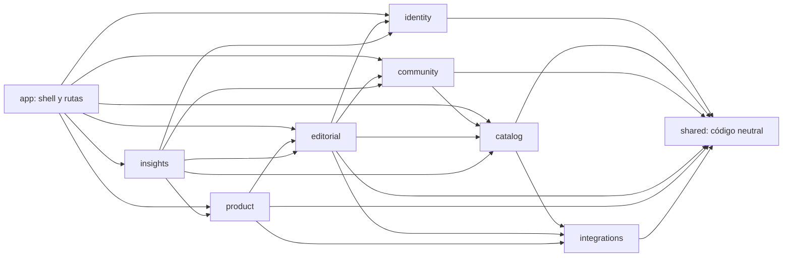

# Arquitectura modular frontend — Iteración 0

**Estado:** Iteración 0 completada el 2026-10-23. Auditoría, diseño y planificación; no se modificó código funcional, tests ni configuración.

**Alcance observado:** frontend Vue 3 + TypeScript + Pinia + Vue Router del checkout actual. Se contrastaron los límites con `../riffvalley-app-back/src/` y sus roadmaps de arquitectura e Identity. No se ejecutaron tests ni verificaciones de runtime; las validaciones de este cambio son documentales.

Los roadmaps frontend existentes de roles, Artists Management, Catalog Import, Catalog Overview y sesiones renovables se conservan como documentos de detalle e historial. Este documento los complementa con ownership modular y orden global; no vuelve a planificar tareas ya cerradas.

## 1. Objetivos y principios

- Organizar vistas, componentes y llamadas HTTP por responsabilidad funcional, con nombres conceptualmente alineados a los dominios reales del backend.
- Migrar gradualmente, vista por vista, conservando URLs, permisos visibles y contratos HTTP.
- Mantener Pinia para sesión y estado global que realmente se comparte. Usar estado local de Vue para formularios, filtros temporales, modales y otras interacciones locales.
- Usar TanStack Query únicamente para datos del servidor cuya caché, deduplicación, refetch o invalidación simplifique trabajo actual.
- Mantener una sola ruta normal para las llamadas API de la aplicación y evitar ciclos entre stores, router, servicios y módulos.
- No añadir capas que solo deleguen una llamada, ni copiar la organización interna de NestJS. Cada carpeta se crea cuando existe código que la necesita.

## 2. Diagnóstico de la arquitectura actual

El código fuente está distribuido principalmente entre `src/views`, `src/components`, `src/services`, `src/stores`, `src/composables`, `src/helpers`, `src/interfaces`, `src/layouts` y `src/router`. Hay agrupación por recurso dentro de algunas carpetas (por ejemplo, `views/list` y `services/spotify`), pero los límites funcionales no se reflejan en una raíz de módulo: una sola vista suele importar servicios, stores, helpers y componentes de varias áreas.

`src/router/index.ts` declara las rutas, importa vistas de `@views` y contiene la inicialización de sesión y las reglas de acceso. `App.vue` combina el shell, el menú, la elección del layout, la espera de sesión y la carga del catálogo. `main.ts` monta plugins y registra la sincronización de sesión entre pestañas. Las rutas son lazy salvo Login. La centralización de rutas es razonable; el guard y el mapa de páginas son candidatos a separar dentro de `app/router/`, sin cambiar nombres ni paths públicos.

La mayoría de las operaciones pasan por `src/services/api/api.ts`, un cliente Axios que añade el access token y coordina renovación, 401 y 403. Hay también llamadas Axios desde ocho componentes `.vue`, un acceso directo a Last.fm desde `ArtistDetail.vue` y un cliente Axios público separado para nacional releases. Algunas llamadas de vista alcanzan la API de la app directamente, por lo que no todas reciben necesariamente la misma política de sesión y errores. El cliente público de nacional releases parece intencional para el formulario público; debe conservarse ese comportamiento al moverlo.

Se encontraron responsabilidades mezcladas en vistas grandes, no una razón para reescribirlas todas:

- `DashboardPage.vue` (1.175 líneas) combina composición del dashboard, varias consultas, estado de cada widget, estadísticas y acciones locales.
- `ContentCalendar.vue` (1.251 líneas) coordina tipos distintos de contenido, consultas, filtros, calendario, backlog y modales especializados.
- `ArtistManagement.vue` (1.501 líneas) mezcla gestión del catálogo, paginación, consultas y flujos asociados a playlists.
- `DiscList.vue` (701 líneas) mantiene filtros, búsqueda, paginación, estados de carga y composición de datos comunitarios.
- `LoginPage.vue` (565 líneas) incluye el formulario de login y personalización visual/preferencias de la propia pantalla.
- `PasswordChange.vue` mezcla cambio de contraseña, avatar, preferencias locales y configuración persistida del dashboard.

El frontend usa una mezcla de Options API, `setup()` y `<script setup>`. La migración no requiere convertir todos los SFC; cada vista se puede dejar con el estilo que ya usa salvo que una extracción concreta aporte claridad.

### Dependencias y problemas confirmados

- Hay un ciclo de imports: `stores/auth/auth.ts` importa `services/activity/appDailyActivity.ts`, que importa `services/api/api.ts`, que vuelve a importar `stores/auth/auth.ts`. Las funciones se invocan en runtime y no se afirma que hoy provoque un fallo, pero el acoplamiento complica inicialización y cambios.
- `services/auth/auth.ts` y `services/users/users.ts` exponen ambas `getUsersRv()` para `/auth/usersRv`, y distintas vistas consumen cada copia. También hay consumidores de este listado que llaman al servicio directamente y otros que pasan por `useUserStore`.
- `SidebarMenu.vue` solicita listas de peticiones y sugerencias para sus contadores. `PetitionsPage.vue` y `SuggestionsManagement.vue` vuelven a solicitar datos relacionados y alimentan stores globales. Esta duplicación puede resolverse con consultas compartidas por clave, después de comprobar que filtros y permisos coinciden.
- Las stores `user`, `asignation`, `catalog`, `petitions` y parte de `support` conservan respuestas del backend fuera de vistas activas. No hay una estrategia uniforme de caducidad, deduplicación, sincronización por parámetros o invalidación tras mutaciones.
- `UserStore.user` duplica campos que ya mantiene Auth (`userId`, nombre, imagen y rol); `fetchUser()` es un stub en memoria y `fetchUser()`/`setUser()` no tienen consumidores encontrados. No se debe retirar nada hasta repetir la búsqueda al cerrar cada migración.
- `AsignationStore` guarda una sola lista sin registrar el `listId` al que pertenece. Varias pantallas la actualizan por ID de lista; al cambiar de lista puede haber datos obsoletos o carreras. Las query keys pueden incluir ese ID y aislar los resultados.
- `PetitionsStore.pendingCount` es un conteo derivado de las peticiones consultadas y almacenado globalmente para menú y página. `SupportStore.pendingIds` vuelve a guardar IDs de sugerencias en progreso recibidos del backend; `readIds` sí es estado local persistido. `readIds` no incluye `userId`, por lo que debe confirmarse si el estado de lectura es por usuario antes de cambiar su clave.
- `CatalogStore` contiene géneros y países de un catálogo compartido, con un `loaded` booleano de vida indefinida. Es un candidato razonable a consulta cacheada; no es necesario mantener Pinia para sus resultados si TanStack Query cubre sus consumidores.
- Hay estado de vista correctamente local en muchos formularios y componentes. No hace falta convertir cada `ref`/`reactive` en store o query; los filtros solo deben pasar al router cuando queramos compartirlos o restaurarlos mediante URL.
- `useDashboardConfig()` mantiene estado editable local y persiste configuración vía API; Auth también carga esa configuración del perfil y la refleja en Pinia/localStorage. Separar la preferencia del estado de sesión y decidir si Query o estado local es dueño debe hacerse al migrar esa funcionalidad, conservando la carga actual del perfil hasta acordar el contrato.
- Las vistas `ArticlesList.vue` y `PublicVersion.vue` no aparecen en el router ni en imports del código consultado. No se afirma que sean obsoletas: registrar su uso y eliminarlas solo si una búsqueda completa posterior confirma que no hay consumidores.

### Tests y verificaciones existentes

El frontend usa Vitest (`yarn test` ejecuta `vitest run`) y `yarn build` incluye `vue-tsc --noEmit` antes de Vite. No se encontró script o configuración E2E de Playwright/Cypress. Se identificaron 19 archivos `*.test.ts`:

- Shell, router y permisos: `src/layouts/default/components/SidebarMenuAuth.test.ts`, `SidebarMenuPermissions.test.ts`, `src/router/authInitialization.test.ts`, `importPermissions.test.ts`.
- Servicios/API: `src/services/activity/appDailyActivity.test.ts`, `api/api.test.ts`, `artist/artist.test.ts`, `auth/sessionAuth.test.ts`, `auth/sessionAuthCoordinator.test.ts`, `catalog/catalog.test.ts`, `imports/imports.test.ts`.
- Store: `src/stores/auth/auth.test.ts`.
- Vistas/features: `src/views/artists/artistManagementPagination.test.ts`, `contentCalendar/components/VideoActionsModal.test.ts`, `discos/MejoresDetalle.test.ts`, `discos/RadarDetalle.test.ts`, `importPage/importResults.test.ts`, `riffValleyPlaylists/RiffValleyPlaylistGenresKanban.test.ts`, `videos/VideosKanban.test.ts`.

La cobertura localizada es más sólida para Identity/session bootstrap, permisos, API, catálogo e import que para formularios de Identity: Login no tiene test propio; no se encontraron pruebas de recuperación/registro público, que tampoco tienen flujo de UI. Esta iteración no ejecutó la batería porque solo cambió documentación.

## 3. Mapa de dominios y módulos

El backend organiza los módulos bajo `identity`, `catalog`, `community`, `editorial`, `communications`, `integrations` y `product`, además de infraestructura `platform`. La propuesta frontend conserva esos límites funcionales cuando hay UX/API asociada, con módulos de composición donde el frontend agrega datos de varios dominios:

| Módulo frontend | Ownership y funcionalidades actuales | Correspondencia backend / observaciones |
|---|---|---|
| `identity` | Login, sesión, roles, solicitud de acceso, contraseña/perfil y administración de usuarios. | Backend `identity/auth`, `users`, `access-requests` y `activity`. La actividad de sesión se registra desde el cliente.
| `catalog` | Discos, artistas, géneros, países, importación, filtros/calendarios y sugerencias de discos del catálogo. | Backend `catalog`. Las rutas Radar/Mejores se asignan a Editorial porque consumen listas editoriales, aunque visualmente muestran discos.
| `community` | Votos/valoraciones, favoritos, comentarios, pendientes y peticiones de alta de discos. | Backend `community`; vistas/componente de disco pueden componer estas acciones con Catalog.
| `editorial` | Listas y asignaciones, Radar/Mejores, reuniones, calendario de contenido, artículos, vídeos, lanzamientos nacionales y playlists editoriales. | Backend `editorial`. Spotify como proveedor es Integrations; los modelos y operaciones de las playlists siguen perteneciendo a Editorial.
| `product` | News, sugerencias/feedback y gestión de versiones/notas. | Backend `product`. Es un módulo adicional necesario que no aparece en la estructura de referencia inicial.
| `integrations` | Acceso a proveedores Spotify, Last.fm y LanguageTool utilizado por funcionalidades de otros módulos. | Backend `integrations`. Hoy no tiene vistas de ruta propias; no crear estructura vacía ni trasladar aquí lógica editorial/catálogo solo por usar un proveedor.
| `insights` | Dashboard, rankings y estadísticas compuestas. | No corresponde a un único módulo backend: reúne datos de Catalog, Community, Identity y Product. Ayuda a mantener estas pantallas agregadoras fuera de un dominio de escritura.
| `help` | Guía de uso y piezas informativas reutilizables. | Sin dominio backend directo; funcionalidad de frontend.
| `app` | Arranque, router, layouts, plugins y pantalla de mantenimiento. | Composición de frontend, no dominio de negocio.
| `communications` | Sin vistas/funcionalidades de usuario identificadas actualmente. | El backend tiene `communications/mail`, usado por otros casos de uso. No crear módulo frontend hasta que exista interfaz o flujo cliente que sea su propietario.

`NationalReleases` se asigna a Editorial porque ese es el ownership backend y porque el flujo combina moderación y publicación; el calendario de discos puede mostrarlo sin convertirse en dueño de sus operaciones. `ArtistManagement` queda en Catalog, pero sus flujos de playlists tienen una dependencia explícita con Editorial. La guía `/how-to-use` queda bajo Help y `/maintenance` bajo el shell App.

### Estructura objetivo de referencia

```text
src/
├── app/
│   ├── router/
│   ├── layouts/
│   └── bootstrap/
├── modules/
│   ├── identity/
│   ├── catalog/
│   ├── community/
│   ├── editorial/
│   ├── product/
│   ├── integrations/
│   ├── insights/
│   └── help/
├── shared/
│   ├── components/
│   ├── composables/
│   ├── api/
│   ├── utils/
│   └── types/
└── main.ts
```

Las carpetas de cada módulo se crean según el código que migre. Por ejemplo, Identity puede necesitar `views/`, `components/`, `api/`, `stores/` y `types/`; un módulo de Integrations sin vistas quizá solo necesite `api/`. No se crean directorios vacíos ni `index.ts` públicos en todos los módulos por convención.

## 4. Reglas de organización y dependencias

- `app/` compone router, layouts, plugins y vistas de estado de la aplicación. Las rutas conservan sus paths y nombres actuales.
- `modules/<dominio>/views/` contiene las páginas propietarias; sus componentes específicos quedan junto al módulo o feature que los usa.
- `api/` contiene funciones HTTP tipadas que llaman al cliente compartido y expresan endpoints reales. No envuelve cada endpoint en un repository o use case.
- `composables/` contiene lógica reactiva que se reutiliza o maneja estado/efectos de un feature. Las consultas y mutaciones de TanStack Query viven preferentemente aquí y llaman a `api/`.
- `stores/` solo se añade si el módulo necesita estado compartido con vida mayor que una vista. No crear store para cada recurso remoto.
- `types/` contiene contratos locales del módulo que se usan en más de una pieza; los tipos de transporte pueden quedarse junto a la función si son pequeños.
- `shared/` es neutral a dominio y contiene elementos que realmente comparten varios módulos, como Axios, selectores genéricos o formatos comunes. Los componentes `Disc*`, `ArtistDetail`, `Comment*`, `VotesModal`, `UserModal` y `SpotifyArtistButton` no son shared por su nombre: deben moverse al ownership real o quedarse hasta comprobar consumidores.
- Un módulo accede a sus propios detalles. Cuando otro necesita una operación, usar solo la función/composable tipado que resuelve esa necesidad; no importar la store interna de otro módulo ni su árbol de vistas.
- No crear APIs públicas genéricas, barrels o contratos entre módulos preventivamente. Crear una exportación estable solo cuando haya un consumidor real.
- Dependencias de módulo propuestas (la flecha indica «depende de»):



Identity no depende de features; el resto solo lee el contrato público de sesión/rol que necesita. App puede componer APIs/composables de dominio para badges y shell. Los módulos no se importan entre sí por detalles internos ni se forman ciclos. Si una pantalla compuesta dificulta el grafo, separar visualmente las responsabilidades con props/eventos antes de crear una capa nueva.

## 5. Inventario completo de rutas y páginas

Las rutas siguientes son las declaradas en `src/router/index.ts`; los paths se conservan durante la migración.

| Módulo propietario | Path público | Nombre de ruta / vista actual | Acceso observado |
|---|---|---|---|
| `insights` | `/` | `Home` — `DashboardPage.vue` | Autenticado |
| `insights` | `/rankings` | `Rankings` — `HomePage.vue` | Autenticado |
| `insights` | `/statistics` | `Statistics` — `Statistics.vue` | Autenticado |
| `catalog` | `/disc-list` | `DiscList` — `DiscList.vue` | Autenticado |
| `catalog` | `/disc-list-error` | `DiscListError` — `DiscListError.vue` | `riffvalley` mínimo |
| `catalog` | `/calendar` | `Calendar` — `DiscCalendar.vue` | `user` mínimo |
| `catalog` | `/calendar-baby` | `CalendarBaby` — `DiscCalendarBaby.vue` | `user` mínimo |
| `catalog` | `/import` | `Import` — `ImportPage.vue` | `superadmin` mínimo |
| `catalog` | `/import-discs` | `ImportDiscs` — `ImportDiscs.vue` | `riffvalley` mínimo |
| `catalog` | `/suggest` | `Suggest` — `SuggestPage.vue` | `user` mínimo |
| `community` | `/petitions` | `Petitions` — `PetitionsPage.vue` | `riffvalley` mínimo |
| `product` | `/suggestions` | `Suggestions` — `SuggestionsPage.vue` | Autenticado |
| `product` | `/suggestions/management` | `SuggestionsManagement` — `SuggestionsManagement.vue` | `superadmin` mínimo |
| `editorial` | `/recap` | `Recap` — `WeekRecap.vue` | `riffvalley` mínimo |
| `editorial` | `/content-calendar` | `ContentCalendar` — `ContentCalendar.vue` | `riffvalley` mínimo |
| `editorial` | `/articles` | `Articles` — `ArticlesKanban.vue` | `riffvalley` mínimo |
| `editorial` | `/list` | `List` — `ListLayout.vue`; redirige `/list/lists` | `riffvalley` mínimo |
| `editorial` | `/list` | `ListDefault` — ruta hija vacía que redirige `/list/lists` | Hereda el acceso del layout |
| `editorial` | `/list/lists` | `ListsList` — `ListsList.vue` | `riffvalley` mínimo |
| `editorial` | `/list/edit/:id` | `EditList` — `EditList.vue` | `riffvalley` mínimo |
| `editorial` | `/list/create` | `CreateList` — `CreateList.vue` | `riffvalley` mínimo |
| `editorial` | `/reunions` | `Reunions` — `ReunionLayout.vue`; redirige `/reunions/list` | `riffvalley` mínimo |
| `editorial` | `/reunions` | `ReunionsDefault` — ruta hija vacía que redirige `/reunions/list` | Hereda el acceso del layout |
| `editorial` | `/reunions/list` | `ReunionsList` — `ListReunion.vue` | `riffvalley` mínimo |
| `editorial` | `/reunions/:id` | `EditReunion` — `EditReunion.vue` | `riffvalley` mínimo |
| `editorial` | `/riff-valley-playlists` | `RiffValleyPlaylists`; redirige a festivales | Sin meta propio; destino protegido |
| `editorial` | `/riff-valley-playlists/festivales` | `RiffValleyPlaylistFestivals` — `RiffValleyPlaylistFestivalsKanban.vue` | `riffvalley` mínimo |
| `editorial` | `/riff-valley-playlists/generos` | `RiffValleyPlaylistGenres` — `RiffValleyPlaylistGenresKanban.vue` | `riffvalley` mínimo |
| `editorial` | `/discos/radar` | `RadarNovedades` — `RadarNovedades.vue` | `riffvalley` mínimo |
| `editorial` | `/discos/radar/:id` | `RadarDetalle` — `RadarDetalle.vue` | `riffvalley` mínimo |
| `editorial` | `/discos/mejores` | `MejoresDiscos` — `MejoresDiscos.vue` | `riffvalley` mínimo |
| `editorial` | `/discos/mejores/:id` | `MejoresDetalle` — `MejoresDetalle.vue` | `riffvalley` mínimo |
| `editorial` | `/videos` | `Videos` — `VideosKanban.vue` | `riffvalley` mínimo |
| `editorial` | `/videos/list/:id` | `VideoListDetalle` — `VideoListDetalle.vue` | `riffvalley` mínimo |
| `catalog` | `/artists` | `ArtistManagement` — `ArtistManagement.vue` | Autenticado en router; backend impone autorización |
| `editorial` | `/national-releases/form` | `NationalReleasePublic` — `NationalReleaseForm.vue` | Público |
| `editorial` | `/national-releases` | `NationalReleasesAdmin` — `NationalReleasesAdmin.vue` | `riffvalley` mínimo |
| `identity` | `/login` | `Login` — `LoginPage.vue` | Público; el guard intenta inicializar sesión |
| `identity` | `/password` | `Password` — `modules/identity/views/PasswordChange.vue` | Autenticado |
| `identity` | `/users` | `Users` — `ManageUsers.vue` | `superadmin` mínimo |
| `identity` | `/users/stats` | `UserStats` — `AdminStats.vue` | `superadmin` mínimo |
| `identity` | `/users/activity` | `UserActivity` — `UserActivity.vue` | `superadmin` mínimo |
| `product` | `/news` | `News` — `ManageNews.vue` | `superadmin` mínimo |
| `product` | `/versions` | `versions-admin` — `ManageVersions.vue` | `superadmin` mínimo |
| `product` | `/versions/kanban` | `versions-kanban` — `VersionKanban.vue` | `superadmin` mínimo |
| `product` | `/patch-notes` | `PatchNotes` — `PatchNotes.vue` | Autenticado |
| `help` | `/how-to-use` | `HowToUse` — `HowToUse.vue` | Autenticado |
| `app` | `/maintenance` | `Maintenance` — `MaintenancePage.vue` | Público; también depende de `VITE_MAINTENANCE_MODE` |

`ArticlesList.vue` y `PublicVersion.vue` existen bajo `src/views/` pero no tienen ruta ni referencia de import encontrada. Los demás componentes y utils bajo `src/views/**/components` o `utils` se asignan junto a la página/feature propietaria, no son rutas independientes.

## 6. Stores Pinia: responsabilidad, consumidores y destino

| Store | Responsabilidad, estado y consumidores encontrados | HTTP/dependencias actuales | Propuesta y riesgo |
|---|---|---|---|
| `auth` — `src/stores/auth/auth.ts` | Sesión compartida: access JWT en memoria, username, id, imagen, rol, estado `initializing/authenticated/anonymous/error`, modo de sesión y generación para descartar respuestas tardías. También guarda preferencias de dashboard. La consumen `main.ts`, App, router, interceptor, Sidebar, login, dashboard, calendario, listas, editorial y componentes compartidos. | `sessionAuthTransport` ejecuta login/refresh/logout; coordina BroadcastChannel; envía actividad diaria. No depende de otras stores. | **Mantener y simplificar por ownership Identity.** Es estado global esencial y no se migra a Query. Separar preferencias de dashboard cuando se migre esa UX. Riesgo alto: interceptor, router, consumidores del token/rol y el ciclo de imports dependen de formas actuales.
| `catalog` — `src/stores/catalog/catalog.ts` | Guarda `genres`, `countries` y `loaded`. Consumidores: App, Rankings, DiscList, Calendar, CalendarBaby, Import, Suggest, Petitions y GenrePlaylistManager. | `fetchCatalog()` llama `getCatalog()`; App precarga al autenticar. Sin dependencias entre stores. | **Migrar el dato remoto a Query** con key `catalog/overview` y una vigencia mayor; eliminar store después de migrar consumidores y comprobar que no necesitan una acción global imperativa. Riesgo bajo/medio: ordenar arrays y timing de carga deben mantenerse.
| `user` — `src/stores/user/users.ts` | Guarda listas admin, usuarios asignables y un `user` singular. La usan ManageUsers, PasswordChange, `useDashboardConfig`, pantallas de List/Radar/Mejores/Vídeo y componentes de asignación. | `getUsers`, `getRvUsers`, create/update/delete vía `services/users/users.ts`; no llama servicios para `fetchUser()`. Sin depender de Auth store, pero `useDashboardConfig` usa ambas. | **Dividir por responsabilidad y migrar listas/remotos a Query.** Mantener solo estado que de verdad cruce vistas, si se identifica. Eliminar `user`, `fetchUser`, `setUser` y `addUser` solo tras confirmar cero consumidores. Riesgo medio/alto: estado optimista, formularios de administración y actualización del perfil tienen consumidores distintos.
| `asignation` — `src/stores/asignation/asignation.ts` | Conserva una lista de asignaciones y getter por id. La comparten List/EditList, Radar/Mejores, WeekRecap y componentes de listas. | Carga por listId y mutations de update/delete; depende de `services/asignation/asignation.ts`. Sin otras stores salvo los componentes consumidores. | **Migrar consultas/mutaciones a Editorial Query composables**, key por `listId`. No conservar la lista como global si Query y la vista cubren esos usos. Riesgo medio: invalidar sincronización entre listados y conservar cambios de orden/optimismo.
| `petitions` — `src/stores/petitions/petitions.ts` | Solo mantiene `pendingCount`. La usan Sidebar y PetitionsPage. | Ambos consumidores calculan el conteo desde peticiones remotas y llaman `setPendingCount`; sin HTTP en la store. | **Eliminar tras migrar**, derivando el badge de la consulta compartida de Community. Riesgo bajo/medio: igualar filtros, rol y definición de estado `pending` en ambas pantallas.
| `support` — `src/stores/support/support.ts` | Comparte `readIds` (Set persistido), `pendingIds` remoto y `unreadCount` derivado. Lo consumen Sidebar y SuggestionsManagement. | No llama HTTP; las vistas/menú obtienen sugerencias y lo alimentan con IDs. | **Conservar solo lectura local si sigue compartida; mover IDs pendientes a la consulta de Product.** Derivar unreadCount de Query + readIds. Riesgo medio: clave persistida no segmentada por userId y semántica de leído por usuario/producto sin validar.

`dashboardButtonsEnabled`, `dashboardConfig` y `mobileDashboardConfig` no son credenciales ni autorización: son preferencias sincronizadas con el perfil y usadas en Dashboard/Password. No deben mantenerse en Auth por comodidad después de desacoplarlas; validar si Query debe ser su dueño remoto y si la parte de edición queda en `ref` local. La store de Auth debe permanecer mínima para sesión, sujeto a conservar el perfil exigido por `refresh-v1`.

## 7. Servicios, API, composables y componentes

### Servicios y llamadas HTTP actuales

Las llamadas están dispersas en más de 30 archivos bajo `src/services/`. Este inventario agrupa todos los servicios por ownership; los nombres de archivo se conservan hasta que migre cada funcionalidad.

| Ownership propuesto | Servicios actuales / familia de endpoints |
|---|---|
| Shared | `api/api.ts` y `api/api.test.ts` (Axios compartido y política de sesión); `swal/SwalService.ts` (notificaciones UI).
| Identity | `auth/auth.ts`, `auth/sessionAuth.ts`, `auth/sessionAuthCoordinator.ts`, `users/users.ts`, `accessRequest/accessRequest.ts`, `activity/appDailyActivity.ts`. Cubren sesión, administración y perfil `/auth/*`, solicitud `/access-requests` y ping `/activity/app/daily`.
| Catalog | `catalog/catalog.ts`, `artist/artist.ts`, `countries/countries.ts`, `discs/discs.ts`, `genres/genres.ts`, `imports/imports.ts`, `lastfm/lastfm.ts`. Cubren catálogo `/catalog`, discos/artistas/géneros/países, importación y operaciones de enriquecimiento Last.fm pertenecientes al caso de uso Catalog.
| Community | `comments/comments.ts`, `favorites/favorites.ts`, `pendings/pendings.ts`, `rates/rates.ts`, `requests/requests.ts`. Cubren contribuciones y estado comunitario de discos/usuarios.
| Editorial | `articles/articles.ts`, `asignation/asignation.ts`, `contents/contents.ts`, `list/list.ts`, `national-releases/nationalReleases.ts`, `points/point.ts`, `reunions/reunions.ts`, `riff-valley-playlists/riffValleyPlaylists.ts`, `videos/videos.ts`; también `spotify/festivalPlaylists.ts` y `spotify/genrePlaylists.ts` para API de playlists editoriales gestionadas por el backend.
| Product | `news/news.ts`, `suggestions/suggestions.ts`, `versions/versions.ts`.
| Integrations | `languagetool/languagetool.ts` y la parte de `spotify/spotifyLookup.ts` que llama a `/spotify/*`. `SpotifyFunctions.ts` requiere revisar callers para distinguir una utilidad de proveedor de lógica específica de Catalog/Editorial.

`auth/auth.ts` y `users/users.ts` duplican `getUsersRv()` para `/auth/usersRv`. `getRvUsers()` también existe en `users/users.ts`; la consolidación debe mantener un tipo de usuario asignable y consumidores de Articles/Videos/Playlists/Lists/Calendar. `spotify/spotifyLookup.ts` mezcla endpoints backend de Integrations (`/spotify/*`) y Catalog (`/discs/spotify/*`); separar por ownership al moverlo, sin cambiar requests. `national-releases/nationalReleases.ts` usa tanto Axios compartido como un Axios público separado para algunas llamadas; ese acceso público es una excepción de transporte, no un segundo ownership.

En vistas/componentes hay imports directos de Axios en `ArtistManagement.vue`, ambos calendarios, `DiscComponent.vue`, los dos kanbans de playlists y sus gestores. `ArtistDetail.vue` llama directamente a Last.fm. En cada migración confirmar si el destino es API backend (`shared/api`) o proveedor externo (`modules/integrations/api`), y conservar las llamadas públicas de formularios. No cambiar contratos HTTP en este roadmap.

### Composables y helpers existentes

- `useIsMobileViewport()` es transversal y se usa en Insights, DashboardBuilder y estadísticas: candidato claro a `shared/composables`.
- `useTheme()` se usa en DefaultLayout y mantiene estado compartido de tema; pertenece a `shared/composables` si sigue usado desde más de un módulo.
- `useDashboardConfig()` pertenece a Dashboard/Insights o a un feature de preferencias de perfil, no a shared. Tiene acoplamiento real a Auth y User stores y migra al aclarar quién posee la configuración remota.
- `artistManagementPagination.ts` y utils de `statistics/` permanecen en sus features. `modules/identity/utils/permissions.ts` contiene la comparación genérica de roles que consumen Router y componentes.
- `dateConstants`, `rejectReasons`, `SpotifyFunctions` y `SwalFuncionts` no se vuelven shared automáticamente; revisar el uso y ownership de cada uno al migrar.

### Componentes existentes

El directorio `src/components/` contiene 14 componentes: `AccessRequestModal`, `ArtistDetail`, `ComentsModal`, `CommentItem`, `DiscCardComponent`, `DiscDetail`, `DiscFilters`, `HowToUseModal`, `SearchableSelect`, `SimpleSelect`, `SpotifyArtistButton`, `StatsModal`, `UserModal` y `VotesModal`. Los primeros están ligados a Identity, Catalog, Community, Integrations/Editorial o Insights. `SearchableSelect` y `SimpleSelect` son candidatos a shared, sujeto a verificar contratos y consumidores en todos los módulos. `HowToUseModal` solo va a shared si realmente se reutiliza fuera de Help.

La mayoría de componentes bajo `src/views/**/components` ya están junto a su feature y deben mantenerse allí. Hay dos `BacklogPanel.vue` distintos —ContentCalendar y Versions— con el mismo nombre pero diferente ubicación/owner; no fusionarlos hasta confirmar que comparten comportamiento y contrato. Componentes que renderizan varias operaciones (por ejemplo, DiscCard con estado personal) se pueden componer con props/eventos; no necesitan acceso directo a stores de todos los dominios.

## 8. Estrategia de estado y adopción de TanStack Query

Se comprobó `package.json`, `yarn.lock` y `src/`: `@tanstack/vue-query`, `vue-query`, `useQuery`, `useMutation` y `QueryClient` no están instalados ni utilizados. No instalar ni configurar durante Iteración 0.

### Responsabilidades

| Responsabilidad | Herramienta propuesta | Casos actuales |
|---|---|---|
| Datos remotos, caché, consultas y mutaciones | TanStack Query | Catálogo, users/admin, asignaciones, listas, contenidos, tasas y datos de página que se vuelven a solicitar.
| Sesión e identidad global compartida | Pinia | Access token en memoria, usuario mínimo, rol y estado de inicialización. No almacenar credenciales en Query.
| Estado temporal de interfaz | Vue `ref`/`reactive`/`computed` | Formularios, modales, sort visual, loading propio de submit y toggles locales.
| Navegación y parámetros compartibles | Vue Router | IDs de detalle y filtros/búsquedas que deban persistir al compartir o recargar URL.

### Convenciones de consultas

- Crear un `QueryClient` y registrarlo en `app/bootstrap` al iniciar la adopción. No añadir persistencia de caché al storage.
- Cada módulo mantiene query keys sencillas bajo un prefijo estable, por ejemplo `['catalog', 'discs']`, `['catalog', 'discs', { genre, country, sort, page }]`, `['editorial', 'lists', listId]` y `['identity', 'users', filters]`. Toda variable usada para pedir datos aparece en la key; IDs, filtros, orden y paginación no se comparten bajo la misma clave.
- Las consultas/mutaciones se declaran en composables del módulo y llaman a sus funciones `api/`. No añadir repositorios ni use cases intermedios.
- Tras una mutación correcta, invalidar las keys concretas afectadas. Para crear/editar una asignación, invalidar el detalle de la lista y las listas derivadas que la muestran. No invalidar toda la aplicación por defecto.
- Usar `useQuery` para página/offset/filter server-side; `useInfiniteQuery` para flujos “cargar más”. Incluir page, limit, search, sort y filtros en la key. Debounce de búsqueda en UI y opcionalmente `placeholderData` para conservar la página anterior mientras carga la nueva.
- Mantener filtros transient en Vue; subirlos a `route.query` solo si deben ser compartibles/restaurables. IDs de recurso permanecen en params actuales.
- Punto de partida de caché a validar: catálogo de géneros/países 10–15 min; listas normales 30–60 s; métricas agregadas 1–5 min; backlog/contenido activo 15–30 s. Cambiar por feature según tasa de cambio y expectativa de frescura.
- Configurar explícitamente retry: máximo un reintento para red/5xx transitorio; no reintentar 401, 403, errores de validación u otros 4xx; no reintentar 429 automáticamente salvo que la vista respete `Retry-After`. La autenticación y la semántica actuales de Axios siguen siendo fuente de política de acceso.
- Mostrar loading, empty, stale data y error en la vista/composable del feature. Evitar toast global por cada error de refetch que luego la vista ya presenta; mantener los mensajes actuales durante migración.
- Estado privado: segmentar keys de datos personales por `userId` cuando sea útil, cancelar peticiones pendientes y limpiar Query al cerrar sesión o sustituir usuario. `QueryClient.clear()` borra query y mutation cache; invocarlo también ante logout recibido por BroadcastChannel. Auth no conserva un espejo de los datos remotos.
- Aplicar Query por caso: mover `CatalogStore` y `AsignationStore` es natural por refetch/deduplicación/keys por lista. Mantener temporalmente un store si su sincronización compartida reduce complejidad y aún no existe una migración segura. Sesión nunca es candidata a Query.

La documentación oficial describe query keys serializables y dependencias de key en [Query Keys](https://tanstack.com/query/latest/docs/framework/vue/guides/query-keys), invalidación por prefijo tras mutaciones en [Invalidations from Mutations](https://tanstack.com/query/latest/docs/framework/vue/guides/invalidations-from-mutations), y la limpieza de query/mutation cache en [QueryClient](https://tanstack.com/query/latest/docs/framework/vue/reference/classes/QueryClient). Sus defaults se deben revisar al adoptar: `staleTime` parte de cero y los errores se reintentan por defecto; aquí conviene fijar defaults propios y selectivos según [Important Defaults](https://tanstack.com/query/latest/docs/framework/vue/guides/important-defaults).

## 9. Identity: estado, contrato actual y evolución prevista

### Flujo y piezas actuales

- `/login` presenta username/password, maneja error de `SessionAuthError` y llama directamente a `authStore.login()`. `AccessRequestModal` se ofrece desde Login; no existe una página de registro público.
- Logout se inicia desde `SidebarMenu.vue`. Auth limpia localmente estado y generación y solicita revocación a `sessionAuthTransport`; la UI informa cuando el backend no confirmó revocación.
- `src/stores/auth/auth.ts` conserva sesión de usuario/rol y access JWT solo en memoria. Los datos CSRF de sesión/logout se guardan en localStorage por origen para soportar pestañas; no son JWT bearer. `sessionAuth.ts` no lee la cookie HttpOnly.
- `sessionAuth.ts` maneja CSRF bootstrap, login, refresh CSRF recovery, refresh y logout con `withCredentials`, DTO validation, errores tipados y cabeceras `refresh-v1`. `sessionAuthCoordinator.ts` coordina pestañas mediante Web Locks/BroadcastChannel.
- `src/services/api/api.ts` adjunta Bearer desde Auth, evita añadirlo a endpoints de sesión, comparte refresh por generación y reintenta una request una sola vez. Un 403 no renueva ni cierra sesión.
- Los errores de sesión se normalizan como `SessionAuthError` (`unauthenticated`, `forbidden`, `rate-limited`, `unavailable`, `conflict`, `bad-request`, `http-error`, `network-error`, `protocol-error`). Un 401 definitivo limpia la sesión; errores transitorios de refresh conservan el estado y bloquean la navegación protegida con opción de reintento; 403 no fuerza logout. Logout distingue revocación confirmada y no confirmada.
- `main.ts` registra eventos remotos de login/logout. Logout remoto limpia el Auth store de otras pestañas del mismo origin; App y el guard esperan inicialización. `router/index.ts` mantiene `requiresAuth`/`requiresRole` y `modules/identity/utils/permissions.ts` ordena los cuatro roles (`user < collaborator < riffvalley < superadmin`). La comprobación del frontend no reemplaza autorización backend.
- `PasswordChange.vue` cambia contraseña y avatar vía servicio de usuario y también gestiona ajustes locales y dashboard. El cambio de contraseña no debe confundirse con login/session API.
- `services/users/users.ts` incluye `/auth/register`, usado por el flujo de alta en `ManageUsers.vue`, además de CRUD/listados. En el frontend consultado no hay formulario público de registro, recovery ni reset de contraseña.
- Tests existentes: `stores/auth/auth.test.ts`, `services/auth/sessionAuth.test.ts`, `sessionAuthCoordinator.test.ts`, `services/api/api.test.ts`, `router/authInitialization.test.ts`, `router/importPermissions.test.ts` y tests de visibilidad de Sidebar. LoginPage no tiene un test específico encontrado; no hay script E2E ni configuración Playwright/Cypress en el frontend.

### Comportamiento vigente y alcance acordado

| Capacidad | Evidencia actual y límite |
|---|---|
| Sesión renovable de 30 días | El frontend actual ya usa `refresh-v1`; su roadmap BC-ID-7 registra la migración App validada/publicada el 2026-10-22. El backend del workspace contiene sesiones persistentes de expiración absoluta 30 días, JWT de acceso corto, refresh HttpOnly rotatorio, CSRF y endpoint de logout. Esta auditoría no repitió prueba contra producción. |
| Independencia App ↔ Wiki | Cada aplicación conserva su propia sesión y gestiona su propio login/logout. No hay SSO ni logout entre aplicaciones y no forman parte del alcance aprobado de esta migración. `BroadcastChannel` coordina exclusivamente pestañas de Riff Valley bajo el mismo origen. |
| Logout | `POST /auth/logout` cierra la sesión de Riff Valley actual; el coordinador propaga el cierre a otras pestañas del mismo origen. No se requiere ni se planifica revocación desde Riff Valley de sesiones de Wiki, otros clientes o dispositivos. |
| Registro público futuro | Backend conserva `POST /auth/register` como requisito de producto para 2027. Frontend no tiene formulario público ahora; el endpoint se usa en administración. Su traslado debe conservarlo, sin abrir antes el flujo público ni inventar permisos/UX. |
| Recuperación de contraseña | No se encontró endpoint/servicio ni flujo frontend en el código consultado. No crear la feature hasta que haya contrato y requisitos de producto. |

### Estructura de Identity propuesta

```text
modules/identity/
├── views/       # Login, password/perfil y administración si se migra en esta fase
├── components/  # Formulario/piezas de identity; solo si separarlas aporta claridad
├── composables/ # Solo lógica reactiva reutilizada, p. ej. roles/perfil si se justifica
├── stores/      # Sesión Pinia
├── api/         # sessionAuth, user admin, access request y actividad identity
└── types/       # Roles y contratos de Identity
```

El guard/router, App bootstrap y Axios compartido permanecen bajo `app/`/`shared/`; Identity no debe absorber infraestructura de toda la aplicación. Las preferencias del Dashboard no son propiedad de sesión, aunque el refresh actual devuelva sus campos.

### Baseline I1-01 — 2026-10-23

#### Contratos y comportamiento que se conservan

- Login: `GET /auth/csrf`, luego `POST /auth/login` con `{ username, password }`, `withCredentials`, `X-Auth-Session-Mode: refresh-v1` y `X-CSRF-Token`. La respuesta validada contiene `token`, usuario/rol y pruebas CSRF para sesión y logout. El backend mantiene la cookie de refresh HttpOnly; el frontend no la lee.
- Contratos HTTP complementarios existentes: `/auth/users`, `/auth/usersRv`, `/auth/users/superusers`, `/auth/users/admin-stats`, `/auth/register`, `PATCH /auth`, `PATCH /auth/superadmin/:id`, `DELETE /auth/:id`, `PATCH /auth/:id/{activate,deactivate}`, `/auth/activity` y `/auth/:id/activity`. Actividad diaria usa `POST /activity/app/daily`; solicitudes de acceso usan el servicio actual bajo `/access-requests`. Payloads, métodos y response DTOs se mantienen tal cual durante el traslado.
- Restauración al arrancar: `App.vue` y el guard llaman al mismo `initializeAuth()`. El store deduplica inicialización concurrente y ejecuta `POST /auth/refresh` con `{}`, cookie, cabecera `refresh-v1`, prueba CSRF y UUID `X-Refresh-Operation`. La respuesta incluye usuario, token, pruebas CSRF y `expiresAt`.
- Renovación: Axios adjunta el access JWT solo a peticiones de recursos. Ante un 401 comparte el refresh por generación de sesión y reintenta una vez; un 401 definitivo cierra localmente la sesión y redirige, y un error temporal conserva el estado. Un 403 no renueva ni cierra sesión. Los endpoints de sesión quedan excluidos del interceptor bearer/refresh.
- CSRF: los valores `rv.auth.session-csrf` y `rv.auth.logout-csrf` viven en localStorage por origen, con migración de los valores legados en sessionStorage. No son tokens bearer. El cliente hace recuperación de CSRF de refresh con `GET /auth/refresh/csrf` y reintenta una vez cuando corresponde.
- Logout: limpia inmediatamente el estado local, emite el evento same-origin y llama `POST /auth/logout` con CSRF de logout; el éxito contractual es HTTP 204. Un error de red/revocación se comunica como no confirmado. El cierre remoto sincroniza pestañas de Riff Valley; las sesiones de Wiki permanecen independientes.
- Roles y navegación: `UserRole` conserva `user < collaborator < riffvalley < superadmin`; `requiresAuth` y `requiresRole`, rutas públicas, URLs, nombres y UX actuales permanecen sin cambios. Las comprobaciones frontend no sustituyen autorización backend.
- Persistencia: el access JWT, usuario y rol se mantienen en memoria. Al iniciar se purgan claves legadas `token`, `username`, `userId`, `image`, `role` y `roles`. Las preferencias de Dashboard sí se guardan en localStorage y no son credenciales.
- El contrato HTTP, `refresh-v1`, la persistencia y renovación actuales, los permisos, rutas y respuesta UX quedan congelados como baseline de migración. Este análisis no contactó servicios desplegados ni cambió código.

#### Archivos, ownership y estado

| Archivo o familia actual | Responsabilidad / destino propuesto |
|---|---|
| `src/views/loginPage/LoginPage.vue`, `src/components/AccessRequestModal.vue` | Login y solicitud de acceso; `modules/identity/views` y `components`. La página usa Auth directamente. |
| `src/views/password/PasswordChange.vue` | Cambio de contraseña/avatar y preferencias de Dashboard. Identity para el flujo de cuenta; separar preferencias solo en su propia migración, no como parte del baseline. |
| `src/views/users/{ManageUsers,AdminStats,UserActivity}.vue` | Administración, estadísticas y actividad de usuarios; vistas de Identity. El formulario público de registro no existe. |
| `src/stores/auth/auth.ts` | Fuente Pinia de sesión global: token efímero en memoria, username/id/avatar/rol, estado y error de inicialización, modo renovable y generación anti-respuesta obsoleta. Mantener en `modules/identity/stores`. |
| `src/services/auth/sessionAuth.ts`, `sessionAuthCoordinator.ts`, `src/services/auth/auth.ts` | Transporte de sesión, coordinación de pestañas, estadísticas/admin y una segunda implementación de `/auth/usersRv`; APIs y tipos migrados y duplicación consolidada en I1-02 sin cambiar contratos. |
| `src/services/users/users.ts`, `src/services/accessRequest/accessRequest.ts` | CRUD/perfil/listados de usuarios y solicitud de acceso; APIs de Identity. `getUsersRv` está duplicado entre `users.ts` y `auth.ts`. |
| `src/interfaces/auth.ts`, `src/helpers/roles.ts` | Tipos de login/rol y helper de jerarquía legacy, trasladados a `src/modules/identity/types/auth.ts` y `src/modules/identity/utils/permissions.ts`. |
| `src/services/activity/appDailyActivity.ts` | Notificación de actividad diaria autenticada; API de Identity. Actualmente usa el Axios compartido. |
| `src/main.ts`, `src/App.vue`, `src/router/index.ts` | Bootstrap, inicialización/sincronización de sesión y guards permanecen en `app/`; integrar el contrato público de sesión sin importar detalles internos. |
| `src/services/api/api.ts` | Cliente Axios transversal y política actual de Bearer/401/403/refresh; permanece en `shared/api` (o infraestructura común equivalente). |
| `src/layouts/default/components/SidebarMenu.vue`, `src/composables/useDashboardConfig.ts`, `src/components/{CommentItem,DiscCardComponent}.vue`, vistas de Dashboard, Articles, Artist Management, Content Calendar, Disc Calendar/DiscComponent, `MisVotosMes`, Login, Password, Riff Valley Playlists, Videos y `WeekLists` | Consumidores legacy que leen sesión/rol, o preferencias dashboard; mantener imports compatibles al principio y migrar por grupos hacia el contrato público de Identity sin importar internals nuevos. Sidebar pertenece al shell; los demás consumidores conservan el ownership de su feature. `main.ts`, App, Router y Axios son consumidores de composición/bootstrap detallados arriba. |

La dependencia circular observada es `auth.ts` (store) → `appDailyActivity.ts` → `api.ts` → `auth.ts` (store). Axios también importa Router y Auth; el store importa la actividad y el coordinator. La store no usa otra store Pinia, pero sí participa en el ciclo de módulos. No se corrigió en I1-01; romperlo requiere separar la inicialización de cliente y las llamadas API en una subtarea posterior, conservando refresh y orden de bootstrap.

Clasificación del estado Auth: sesión/usuario mínimo y rol son globales y deben permanecer en Pinia; `authStatus`, error, modo y generación son estado global de ciclo de sesión; el token es estado sensible efímero, nunca persistido ni de TanStack Query. Preferencias de Dashboard son persistencia local asociada al perfil/UI, hoy mezclada en Auth, no estado de autenticación. Los datos admin (`users`, actividad, estadísticas) son remotos y pueden migrar a Query; formularios, selección y loading de pantalla son locales. `loggedUser`, `avatarUrl`, `isAuthenticated` y `hasRole` son derivados.

#### Cobertura ejecutada

Comando focalizado: `yarn test src/stores/auth/auth.test.ts src/services/auth/sessionAuth.test.ts src/services/auth/sessionAuthCoordinator.test.ts src/services/api/api.test.ts src/router/authInitialization.test.ts src/router/importPermissions.test.ts src/layouts/default/components/SidebarMenuAuth.test.ts src/layouts/default/components/SidebarMenuPermissions.test.ts src/services/activity/appDailyActivity.test.ts`.

- **Aprobadas:** 9 archivos, 59 tests; incluyen login/validación, restauración, refresh y recuperación CSRF, logout confirmado/no confirmado, coordinación same-origin, concurrencia y respuestas obsoletas, interceptor 401/403, guards/roles, logout desde Sidebar y actividad.
- **Fallidas:** ninguna.
- **Omitidas/no disponibles:** no hay test específico de `LoginPage.vue`, registro público ni recuperación/reset de contraseña; no hay configuración/script E2E Playwright/Cypress identificado.
- **Entorno:** durante un caso de bootstrap Vitest registró `connect EPERM 127.0.0.1:3000`; el caso y la suite pasaron. El entorno bloqueó esa conexión local. No se ejecutó nada contra producción ni servicios externos.
- Advertencia preexistente al correr Vitest: base de Browserslist `caniuse-lite` con 20 meses de antigüedad. Se reporta sin modificar dependencias.

#### Aceptación de I1-01

- Inventario de consumidores y dependencias del flujo de sesión revisado; paths, payloads, roles, rutas y errores se dejan documentados como contrato a preservar.
- Dependencia circular Auth/actividad/Axios registrada como hallazgo preexistente, sin corregirla.
- Tests existentes relacionados enumerados y baseline focalizado ejecutado con 9 archivos/59 aprobados.
- **Resultado:** criterios de I1-01 cumplidos; sin cambios funcionales.

## 10. Roadmap de migración

La Iteración 0 se cierra con este documento. La Iteración 1 funcional migra primero login y sesión conservando el comportamiento que ya existe; no reimplementa `refresh-v1`, no introduce SSO y no altera contratos. Cada subtarea de ejecución incluye objetivo, alcance, dependencias, aceptación, verificaciones, tamaño y estado.

### Iteración 1 — Identity

#### I1-01 XS — Cerrar baseline de contratos y consumidores

- **Objetivo:** fijar paths, payloads, errores, estados, consumers y comportamiento actual antes de mover piezas.
- **Alcance:** login/logout, refresh, CSRF, user/role, store, router, App, Axios, localStorage y eventos multipestaña. Registrar diferencias entre código frontend, contrato backend y rollout vigente.
- **Dependencias:** ninguna.
- **Criterios de aceptación:** inventario de consumidores completo; ningún cambio a endpoints, rutas, roles ni respuesta UX acordado implícitamente.
- **Verificaciones:** revisión de imports y roadmaps Identity; tests existentes listados como baseline.
- **Tamaño:** XS.
- **Estado:** completada el 2026-10-23; baseline, dependencias y 9 archivos/59 tests registrados en la sección «Baseline I1-01».

#### I1-02 XS — Organizar contratos y API de Identity

- **Objetivo:** dar ownership modular a tipos y llamadas de Identity.
- **Alcance:** ubicar session transport, usuario/admin, access request y actividad bajo `modules/identity/api`/`types`; consolidar duplicación de `/auth/usersRv` durante el traslado, manteniendo consumidores y DTOs. No crear wrappers de delegación.
- **Dependencias:** I1-01.
- **Criterios de aceptación:** cada endpoint de Identity tiene una implementación frontend; tipos conservan la forma actual; no quedan imports a la copia retirada.
- **Verificaciones:** tests de sesión y consumers, typecheck y búsqueda de imports/implementaciones duplicadas.
- **Tamaño:** XS.
- **Estado:** completada el 2026-10-23.

##### Resultado I1-02 — 2026-10-23

- **APIs movidas:** `services/auth/sessionAuth.ts` y `sessionAuthCoordinator.ts` a `modules/identity/api/`; `services/auth/auth.ts` y `services/users/users.ts` se consolidaron en `modules/identity/api/users.ts`; access request y actividad diaria se movieron desde sus carpetas de `services/` a `modules/identity/api/`.
- **Tipos movidos:** `interfaces/auth.ts` a `modules/identity/types/auth.ts`; contratos de sesión, usuarios/admin/actividad y solicitud de acceso se organizaron en `types/session.ts`, `types/users.ts` y `types/accessRequest.ts`. `SessionAuthError` se mantiene en el transporte porque es una clase runtime usada para clasificar errores.
- **Consumidores actualizados:** store Auth, bootstrap `main.ts`, helper de roles, Router/Sidebar, Login y AccessRequestModal, store de usuarios, vistas y componentes que consumían endpoints o DTOs de Identity. Los tests que importaban rutas antiguas se actualizaron para apuntar al módulo; permanecen en sus ubicaciones.
- **Consolidación:** `/auth/usersRv` tiene una única función, `getRvUsers`, en `modules/identity/api/users.ts`; se retiró `getUsersRv` duplicada y sus consumidores usan el nombre canónico existente. No se dejó fachada ni reexport temporal; la búsqueda no encontró imports a las rutas eliminadas.
- **Contratos conservados:** rutas, métodos, payloads y respuestas HTTP no cambiaron. `refresh-v1`, CSRF, cookies, renovación, logout same-origin y sesiones independientes App/Wiki conservan su implementación. El cliente Axios transversal permanece en `src/services/api/api.ts` y las APIs de Identity lo consumen sin dependencia hacia el store.
- **Verificaciones:** `yarn test` focalizado: 11 archivos/68 tests aprobados; `yarn vue-tsc --noEmit`: aprobado; `git diff --check`: aprobado. El repo no tiene script ni dependencia de lint configurados. Sin test dedicado del API de usuarios, se comprobaron los consumers con typecheck y tests de vistas existentes.
- **Pendiente:** el ciclo Auth → actividad diaria → Axios → Auth continúa como hallazgo del baseline; modularizar las APIs no lo resolvió ni añadió otra dependencia. El store y el cliente compartido siguen en sus ubicaciones actuales para I1-03/I1-04.
- **Resultado:** criterios de aceptación de I1-02 cumplidos; no se implementó I1-03.

#### I1-03 S — Mantener sesión mínima en Pinia

- **Objetivo:** llevar la fuente única de sesión a Identity y separar su responsabilidad de datos remotos/preferencias.
- **Alcance:** mover/simplificar `auth` preservando access token en memoria, estado de inicialización/error, perfil mínimo, rol, barrera de generación y acciones actuales. Decidir dashboard preferences aparte sin perderlas.
- **Dependencias:** I1-02.
- **Criterios de aceptación:** todos los consumidores usan un único store; token no se persiste ni pasa a Query; campos de CSRF siguen siendo los únicos datos de protocolo compartidos por storage.
- **Verificaciones:** `auth.test.ts`, consumers de `useAuthStore`, storage y regresión de cambio de cuenta.
- **Tamaño:** S.
- **Estado:** completada el 2026-10-23.

##### Resultado I1-03 — 2026-10-23

- **Store de sesión:** `src/stores/auth/auth.ts` pasó a `src/modules/identity/stores/auth.ts`; `useAuthStore` conserva su id público de Pinia, acciones y getters de sesión. Mantiene token efímero, usuario mínimo (id, username, imagen), rol, estado/error de inicialización, modo renovable y generación anti-respuesta obsoleta. Login, restauración, renovación, 401, logout same-origin y coordinación entre pestañas siguen delegados al transporte y coordinator migrados en I1-02. No se cambió el cliente Axios ni se resolvió el ciclo con actividad diaria.
- **Preferencias del Dashboard:** se retiraron del estado Auth. `src/modules/identity/stores/dashboardPreferences.ts` mantiene la configuración desktop/mobile y el ajuste de botones del menú, con las mismas claves y persistencia local; `src/modules/identity/composables/useDashboardPreferences.ts` es el acceso usado por Sidebar, Password y `useDashboardConfig`. El transporte de sesión conserva los campos del perfil y Auth los aplica tras login/refresh, sin guardarlos en el store de sesión. Esta preferencia de perfil introduce la dependencia dirigida `insights → identity` en el grafo; Identity no depende de Insights.
- **Consumidores:** imports de `useAuthStore` actualizados en App, bootstrap, Router, Axios y consumidores de vistas/componentes/tests. Sidebar, Password y `useDashboardConfig` ahora leen/escriben preferencias por el composable de Identity. Los tests del store se movieron junto con Auth.
- **Verificaciones:** tests focalizados de sesión, Login/Auth store, refresh/logout, 401, roles, restauración, Router, Sidebar, Axios y consumidores: 10 archivos/67 tests aprobados. `yarn vue-tsc --noEmit`: aprobado. `git diff --check`: aprobado. El test de inicialización de Router registra un `connect EPERM 127.0.0.1:3000` en stderr, pero sus 2 tests pasan.
- **Riesgo pendiente:** continúa el ciclo Auth → actividad diaria → Axios → Auth identificado en I1-01. Resolverlo requiere reorganizar el cliente compartido/bootstrap y pertenece a I1-04; no se cambió aquí.
- **Resultado:** criterios de I1-03 cumplidos; la sesión tiene una fuente Pinia bajo Identity, no persiste credenciales, y las preferencias del Dashboard están fuera de Auth. No se implementó I1-04.

#### I1-04 S — Conectar bootstrap, HTTP y router al store modular

- **Objetivo:** preservar el orden de inicialización y renovación con nuevos imports/ownership.
- **Alcance:** coordinar `main.ts`, App, router/guards, cliente Axios compartido, refresh concurrency y eventos entre pestañas. Resolver el ciclo Auth → daily activity → api → Auth sin cambiar la API pública.
- **Dependencias:** I1-03.
- **Criterios de aceptación:** primera navegación protegida espera restauración; fallo temporal no se interpreta como anónimo; 401/403 mantienen política; petición elegible solo se reintenta una vez; URLs y permisos intactos.
- **Verificaciones:** `authInitialization`, `importPermissions`, `api`, `sessionAuthCoordinator` y build/typecheck.
- **Tamaño:** S.
- **Estado:** completada el 2026-10-23.

##### Resultado I1-04 — 2026-10-23

- **Dependencias antes:** Axios importaba directamente `useAuthStore` y el Router para adjuntar Bearer, renovar tras 401, cerrar sesión y redirigir. Auth llamaba a `appDailyActivity`, que enviaba la actividad a través del mismo Axios; el ciclo era `Identity Auth → actividad diaria → Axios → Identity Auth`. Además existía el borde `Axios → Router`.
- **Dependencias después:** `src/main.ts` compone Pinia, Auth, Axios y Router: configura callbacks de lectura/renovación/limpieza/logout y navegación en Axios antes de instalar Router, que inicia la navegación inicial. Axios ya no importa el store Auth ni Router; recibe la sesión mediante `configureApiAuth`. El trayecto `Auth → actividad diaria → Axios` permanece unidireccional. El guard de `src/router/index.ts` sigue consultando `initializeAuth()` y el rol del store modular; no hubo cambios de paths, reglas ni permisos.
- **Archivos I1-04:** `src/main.ts`, `src/services/api/api.ts`, `src/services/api/api.test.ts` y este roadmap. El cliente compartido conserva su instancia e interceptores; solo cambia cómo recibe acceso a sesión y navegación.
- **Comportamiento/contratos:** no cambiaron endpoints, métodos, headers, payloads ni DTOs. Se conserva `refresh-v1`, CSRF por origen, Bearer en memoria, refresh compartido por generación, reintento máximo de una vez, reutilización del token renovado para 401 tardíos, tratamiento separado de 401/403, logout y sincronización same-origin. La inicialización concurrente sigue deduplicada por Auth; Router espera su resultado y mantiene los fallos temporales en error sin redirigir a anónimo. Riff Valley y Wiki mantienen sesiones independientes.
- **Verificaciones:** tests focalizados: 9 archivos/59 tests aprobados (`auth.test`, transporte/coordinator de sesión, actividad diaria, Axios, inicialización/roles del Router y Sidebar auth/permisos). Incluyen refresh simultáneo, retry único, 401/403, logout y guardas. `yarn vue-tsc --noEmit`: aprobado. `git diff --check`: aprobado. La búsqueda de imports confirma que `api.ts` no importa Auth ni Router. No hay script/dependencia de comprobación automática de ciclos en el proyecto; el grafo afectado se revisó directamente.
- **Avisos del entorno:** el test de bootstrap registra `connect EPERM 127.0.0.1:3000` en stderr, pero pasa; Vitest también muestra el aviso preexistente de la base Browserslist antigua. Ninguno se modificó.
- **Riesgos pendientes:** no se identifican cambios de semántica pendientes dentro de I1-04. El entorno no dispone de un detector automatizado de ciclos; revisar manualmente las dependencias afectadas es la verificación disponible. El ciclo conocido queda eliminado.
- **Resultado:** criterios de I1-04 cumplidos; no se implementó I1-05.

#### I1-05 S — Migrar Login y solicitud de acceso

- **Objetivo:** hacer de Login la primera vista modular de referencia sin trasladar política de sesión al componente.
- **Alcance:** vista, acceso a `authStore.login`, estados/errores y `AccessRequestModal`; mantener tema/modos visuales actuales y su storage fuera del token.
- **Dependencias:** I1-02 e I1-03.
- **Criterios de aceptación:** mismo formulario, respuesta visual, solicitud de acceso y navegación; el SFC no contiene Axios, CSRF ni refresh.
- **Verificaciones:** test de Login o prueba de flujo focalizada; tests de store/transporte; comprobación manual de login/error si hay backend disponible.
- **Tamaño:** S.
- **Estado:** completada el 2026-10-23.

##### Resultado I1-05 — 2026-10-23

- **Archivos migrados:** `src/views/loginPage/LoginPage.vue` → `src/modules/identity/views/LoginPage.vue` y `src/components/AccessRequestModal.vue` → `src/modules/identity/components/AccessRequestModal.vue`. No se creó un store ni un composable para el formulario. Username, password, loading, error y visibilidad de modales permanecen en estado Vue local; la sesión sigue en el store Auth de Identity. `HowToUseModal.vue` permanece compartido como pieza genérica de ayuda.
- **Imports y consumidores:** `src/router/index.ts` importa la vista desde `modules/identity/views`; conserva path `/login`, nombre `Login`, metadatos, guard y permisos. La vista importa `AccessRequestModal` desde Identity, `HowToUseModal` desde shared y conserva el uso de `useAuthStore` y `SessionAuthError` ya migrados. La búsqueda de consumidores encontró a Login como único consumidor de `AccessRequestModal`; no quedan imports desde las ubicaciones retiradas.
- **Tests:** añadido `src/modules/identity/views/LoginPage.test.ts` con cobertura del formulario, envío de credenciales, carga/disabled, mensaje de credenciales inválidas y navegación a `Home`. No se modificaron pruebas existentes.
- **Comportamiento preservado:** se conserva el login mediante `authStore.login`, payload `{ username, password }`, estados y mensajes por categoría de error, y navegación a `Home` tras éxito. Se mantienen sin cambios solicitud de acceso y sus mensajes, tema/modos y storage visual, restauración/renovación `refresh-v1`, CSRF, tratamiento 401/403, guards, roles, permisos, URLs y la independencia de sesión con Wiki. El SFC no implementa Axios, CSRF ni refresh.
- **Verificaciones:** `yarn test` focalizado de Login, Auth store, Axios, Router/guards y Sidebar: 7 archivos/41 tests aprobados; transporte/coordinator y actividad de sesión: 3 archivos/21 tests aprobados. Total: 10 archivos/62 tests aprobados. `yarn vue-tsc --noEmit`: aprobado. `git diff --check`: aprobado. No se ejecutó prueba manual contra backend; no se confirmó disponibilidad de un backend de prueba.
- **Avisos y riesgos pendientes:** el test de inicialización del Router registra `connect EPERM 127.0.0.1:3000` en stderr, pero pasa; también aparece el aviso preexistente de `caniuse-lite` antiguo. El detector Impeccable señala `overused-font` por `Inter` en el estilo existente de Login (línea 563 tras el traslado); no se cambió estilo ni configuración por ser ajeno a I1-05. Queda pendiente el smoke manual de login/error cuando exista backend disponible.
- **Resultado:** criterios de aceptación de I1-05 cumplidos; vista y solicitud de acceso bajo Identity, sin alterar la presentación ni el comportamiento. No se implementó I1-06.

#### I1-06 XS — Conservar roles, guards y permisos

- **Objetivo:** mantener política de navegación y exposición de menús al mover Identity.
- **Alcance:** tipado de `UserRole`, `hasMinimumRole`, route meta y consumidores de rol; reemplazar referencias internas sin tocar la jerarquía ni dar por válida una comprobación UI como autorización.
- **Dependencias:** I1-03 e I1-04.
- **Criterios de aceptación:** paths/nombres/meta y roles `user < collaborator < riffvalley < superadmin` iguales; rutas públicas siguen públicas.
- **Verificaciones:** tests de guards/import y Sidebar auth/permissions.
- **Tamaño:** XS.
- **Estado:** completada el 2026-10-23.

##### Resultado I1-06 — 2026-10-23

- **Inventario y ownership:** `UserRole` y `USER_ROLES` ya residían en `src/modules/identity/types/auth.ts`; la jerarquía canónica sigue siendo `user < collaborator < riffvalley < superadmin`. El helper genérico `hasMinimumRole` pasó de `src/helpers/roles.ts` a `src/modules/identity/utils/permissions.ts`. No se creó un motor ni un mapa nuevo de permisos.
- **Reglas específicas:** `src/router/index.ts` conserva `requiresAuth`/`requiresRole` en los metadatos y el guard existente, incluidos `initializeAuth()`, la decisión ante estado transitorio, redirección a Login para usuarios anónimos y Home ante rol insuficiente. Los umbrales y condiciones de cada ruta siguen declarados en Router. `routes.json` mantiene los filtros de navegación propios del Sidebar. Catalog conserva las condiciones de moderación/edición en DiscCard, calendarios y ArtistManagement; Editorial conserva la condición de gestión de playlists; Identity conserva las condiciones de cambio de perfil/contraseña y administración. Son decisiones de visibilidad de cada consumidor, basadas en el helper genérico cuando corresponde.
- **Consumidores actualizados:** Router, Sidebar, DiscCardComponent, DiscCalendar, DiscComponent, RiffValleyPlaylistFestivalsKanban, PasswordChange y ArtistManagement importan desde Identity. El rol de sesión continúa en `useAuthStore`; no se modificó el store ni la validación/representación de rol en las respuestas de sesión. No hay consumidores de `hasRole()` fuera de Auth.
- **Comportamiento y contratos:** paths, nombres y metadatos de rutas, rutas públicas, jerarquía y mínimos de rol, menús, controles y redirecciones permanecen intactos. El usuario sin autenticación sigue siendo denegado por las rutas protegidas y enviado a Login. La UI solo guía navegación/presentación; la autorización efectiva sigue siendo backend. No cambiaron contratos HTTP ni `refresh-v1`.
- **Verificaciones:** añadido `src/modules/identity/utils/permissions.test.ts` para todos los pares de la jerarquía y roles ausentes/desconocidos. Los tests focalizados de permisos, Auth, guards/import y Sidebar (incluida visibilidad por rol) aprobaron: 6 archivos/28 tests. `yarn vue-tsc --noEmit` y `git diff --check` aprobaron. El detector Impeccable devolvió `[]` para los SFC afectados.
- **Riesgos pendientes:** la cobertura es unitaria y de Router/componentes; no hay E2E configurado ni se probó contra backend. Estas pruebas no verifican autorización efectiva del servidor. Permanecen avisos preexistentes de entorno documentados en I1-04/I1-05 (conexión local `EPERM` durante bootstrap y base Browserslist antigua); no se alteraron.
- **Resultado:** criterios de I1-06 cumplidos. No se implementó I1-07.

#### I1-07 S — Migrar logout y coordinación multipestaña

- **Objetivo:** conservar revocación remota y cierre local con resultado explícito.
- **Alcance:** logout desde Sidebar, cambio de generación, limpieza local, CSRF de logout, BroadcastChannel y mensajes de revocación no confirmada. No ampliar el logout actual a sesiones de otras apps.
- **Dependencias:** I1-02, I1-03 e I1-04.
- **Criterios de aceptación:** store se limpia sin esperar a red; logout backend confirmado o advertencia no confirmada; todas las pestañas de App reaccionan; ningún secreto se publica en el canal.
- **Verificaciones:** tests store, transport, coordinator, interceptor y flujo visible de logout.
- **Tamaño:** S.
- **Estado:** completada el 2026-10-23.

##### Resultado I1-07 — 2026-10-23

- **Flujo inventariado antes del ajuste:** el usuario inicia el logout desde el botón de `SidebarMenu.vue`; el componente llama `authStore.logout()`, navega a `Login` inmediatamente y muestra una advertencia si la revocación queda sin confirmar. El store invalida primero su generación, access token en memoria, perfil y claves legacy; emite `logout` en el canal `riffvalley-app-auth-session` y delega la revocación al transporte. El transporte espera un refresh en curso, toma el lock por origen, usa la prueba CSRF de logout compartida y envía `POST /auth/logout` con cookies; exige `204`, limpia las pruebas CSRF al confirmar o recibir 401 y clasifica el resto de errores como revocación no confirmada.
- **Otras causas de cierre:** `renewSession()` y la restauración inicial limpian y notifican a las demás pestañas cuando Identity confirma que la sesión ya no existe (401). Axios no considera 403 una expiración. Si una request sigue devolviendo 401 después del único retry, solicita `authStore.logout()` para intentar revocar y advierte si no puede confirmar; un refresh temporal fallido conserva la sesión. Las pestañas receptoras limpian el store y redirigen rutas protegidas desde el callback de composición de `main.ts`, sin volver a emitir el evento ni solicitar otra revocación. El Router protege el resto de navegaciones mediante `requiresAuth` y `initializeAuth()`.
- **Flujo después y responsabilidades:** se conserva el mismo flujo y ownership. En `src/modules/identity/stores/auth.ts`, un helper privado comparte la operación local de invalidar generación/credenciales y publicar el evento entre logout explícito y expiraciones definitivas. El 401 de refresh no llama al endpoint de logout de nuevo. El store devuelve `confirmed`, `already-absent` o `unconfirmed`; Sidebar conserva la navegación y el aviso de interfaz. El transporte conserva contrato, CSRF, cookies, Web Locks y errores. El coordinator solo comunica entre pestañas del mismo origen. La composición en `main.ts` atiende logout remoto y redirige; Axios mantiene refresh/retry y delega la invalidación a Identity.
- **Duplicación y límites:** no había consumidores con llamadas directas duplicadas a `sessionAuthTransport.logout()` ni más botones de logout que Sidebar. Había dos ramas idénticas de expiración definitiva (restauración y renovación) que limpiaban y emitían por separado; ahora comparten la misma función interna. Riff Valley y Wiki siguen con sesiones independientes; el canal no cruza aplicaciones ni se publican tokens o pruebas CSRF.
- **Archivos afectados por I1-07:** `src/modules/identity/stores/auth.ts` consolida limpieza+broadcast; `src/modules/identity/stores/auth.test.ts` añade cobertura del 401 durante renovación y comprueba que no se solicita logout remoto redundante; este roadmap registra ownership, flujo y preparación para Query. Los consumidores inspeccionados sin cambios son `src/layouts/default/components/SidebarMenu.vue`, `src/main.ts`, `src/services/api/api.ts`, `src/modules/identity/api/sessionAuth.ts`, `src/modules/identity/api/sessionAuthCoordinator.ts` y `src/router/index.ts`.
- **Cobertura y verificaciones:** 7 archivos/56 tests aprobados: store Auth (15), transporte `refresh-v1` (13), coordinator multipestaña (7), Axios/interceptor (12), Sidebar logout (2), bootstrap del Router (2) y permisos/import (5). Incluyen revocación confirmada/no confirmada/401, limpieza local, propagación entre pestañas, lock refresh/logout, cabecera CSRF/cookies y 204, 401/403, retry único y redirección/guards. `yarn vue-tsc --noEmit` aprobado; `git diff --check` aprobado. No se hizo smoke contra backend.
- **Avisos y riesgos pendientes:** el test de bootstrap vuelve a registrar `connect EPERM 127.0.0.1:3000` aunque pasa; Browserslist avisa que `caniuse-lite` tiene 20 meses. No se cambiaron por ser avisos preexistentes. La cobertura de cierre remoto de UI y revocación real es unitaria; queda el smoke con backend y no hay E2E configurado. Una falla de red durante logout sigue permitiendo cerrar localmente y se comunica como revocación no confirmada, que podría dejar viva la cookie en el servidor según el contrato existente.
- **Preparación para I1-09:** cuando exista QueryClient, la limpieza de caché privada debe componerse desde `main.ts` o una coordinación simple equivalente para cubrir tanto logout local como expiración/logout remoto. Limpiar la caché al observar la transición de sesión autenticada a anónima y ante eventos de logout remoto; no importar QueryClient desde Auth ni añadir dependencias antes de I1-09.
- **Resultado:** criterios de aceptación de I1-07 cumplidos; el logout permanece centralizado en Identity sin cambiar comportamiento observable ni contratos. No se implementó I1-08.

#### I1-08 S — Delimitar contraseña, perfil y registro

- **Objetivo:** separar las operaciones de cuenta de la sesión y mantener la ruta de registro preparada para el futuro.
- **Alcance:** `/password`, cambio de contraseña/avatar, preferencias de usuario y llamadas de alta; mantener `POST /auth/register` de administración y documentar que no existe UX pública/recovery. Dashboard preferences no deben quedar dentro del store de sesión por conveniencia.
- **Dependencias:** I1-02 e I1-03.
- **Criterios de aceptación:** cambio de contraseña/perfil mantiene endpoint y permisos; registro no se elimina ni se transforma en registro público; preferencias persistidas siguen disponibles.
- **Verificaciones:** tests focalizados de Password, store/API de usuario, Auth y Router; imports de `useDashboardConfig`; revisión de requests; `yarn vue-tsc --noEmit`, `git diff --check` y smoke de Password si hay backend disponible.
- **Tamaño:** S.
- **Estado:** completada el 2026-10-23.

##### Resultado I1-08 — 2026-10-23

- **Funcionalidades encontradas:** `/password` presenta avatar, cambio de contraseña y ajustes personales. La contraseña y el avatar se actualizan mediante `useUserStore().updateUserStore()` y `PATCH /auth`; el avatar también actualiza el campo de imagen en Auth en memoria. Las preferencias del dashboard persisten mediante el store Identity separado en I1-03 y se sincronizan con el backend desde la lógica existente. Año por defecto, modo de apertura de Spotify y No Spoilers usan `localStorage` y eventos del navegador. La solicitud de acceso durante la beta existe en Login como `AccessRequestModal` y ya se migró en I1-05; no se volvió a mover aquí. Los formularios, modal y estados de carga/error permanecen en Vue.
- **Capacidades existentes fuera de esta migración:** `POST /auth/register` continúa en `modules/identity/api/users.ts` y solo se usa desde la administración de usuarios; la operación de esa vista se migrará en I1-10b. No hay formulario público de registro ni endpoint/servicio o pantalla de recuperación/restablecimiento de contraseña. La recuperación CSRF de `refresh-v1` corresponde a sesión, no a recuperación de contraseña. No se habilitó ni añadió ninguna de estas experiencias.
- **Archivos migrados:** `src/views/password/PasswordChange.vue` → `src/modules/identity/views/PasswordChange.vue`; `src/views/password/components/DashboardBuilder.vue` y `ModuleCard.vue` → `src/modules/identity/components/account/`. No se duplicaron piezas ni se crearon stores. `useDashboardConfig` permanece en `src/composables/` porque también lo consume la vista Dashboard; el store/composable de preferencias sigue separado de Auth según I1-03.
- **Consumidores actualizados:** `src/router/index.ts` importa `PasswordChange` desde Identity. Se conservan path `/password`, nombre `Password`, `requiresAuth`, guard y redirecciones. Las subpiezas de cuenta ajustan sus imports relativos; no quedan referencias al directorio retirado `src/views/password/`. La administración y sus rutas no se migraron.
- **Comportamiento y contratos preservados:** se mantienen reglas de validación y mensajes, llamadas `PATCH /auth`, carga/errores y éxito, cambio inmediato del avatar en memoria, preferencias de dashboard/usuario y permisos actuales. Se conserva `POST /auth/register` con su payload y endpoint de administración. No cambiaron endpoints, DTOs, cookies, CSRF, Bearer en memoria, renovación `refresh-v1` ni sesión independiente App/Wiki. No se introdujo TanStack Query.
- **Pruebas y verificaciones:** tests focalizados de perfil/contraseñas, contrato HTTP de perfil/registro, Auth, transporte/coordinación de sesión, Axios y Router: 8 archivos/60 tests aprobados. Incluyen validación y confirmación de contraseña, actualización de avatar, error al guardar preferencias, método/URL del contrato y restricción autenticada de `/password`. `yarn vue-tsc --noEmit`, `git diff --check` y detector Impeccable para los SFC migrados aprobaron (`[]`).
- **Riesgos pendientes:** no se hizo smoke de perfil contra backend y no hay E2E configurado. Los tests verifican la invocación del store y el contrato cliente, no la persistencia real del servidor. Persisten avisos preexistentes: `connect EPERM 127.0.0.1:3000` durante el test de bootstrap y base Browserslist `caniuse-lite` antigua; no se modificaron. La recuperación de contraseña sigue pendiente de contrato y requisitos de producto.
- **Resultado:** criterios de aceptación de I1-08 cumplidos. No se implementó I1-09.

#### I1-09 XS — Instalar base mínima de TanStack Query y limpieza privada

- **Objetivo:** establecer Query solo cuando la siguiente subfuncionalidad Identity migre datos remotos.
- **Alcance:** QueryClient/plugin con stale/retry deliberados y limpieza al logout/cambio de usuario; sin persistencia en storage, sesión, credenciales ni endpoints de login/refresh en Query.
- **Dependencias:** I1-04 e I1-07.
- **Criterios de aceptación:** no hay datos privados reutilizables tras logout/cambio de usuario; Query no controla la sesión y no duplica el store Auth.
- **Verificaciones:** tests de QueryClient lifecycle y build/typecheck; validar invalidación en evento remoto de logout.
- **Tamaño:** XS.
- **Estado:** completada el 2026-10-23.

##### Resultado I1-09 — 2026-10-23

- **Dependencia instalada:** `@tanstack/vue-query` `^5`, resuelta en `yarn.lock` a `5.104.5`. El proyecto usa Vue `3.5.13` y TypeScript `5.6.3`; Vue satisface el peer range del plugin (`^2.6.0 || ^3.3.0`). La instalación se hizo con Yarn 4.10.1.
- **Composición:** `src/app/queryClient.ts` exporta una sola instancia compartida, crea el `QueryClient` y registra `VueQueryPlugin` con `installQuery(app)`. `src/main.ts` instala Query tras Pinia y antes de Router, conservando el orden de inicio y una única instancia.
- **Defaults:** `staleTime` 60 s y `gcTime` 5 min reducen recargas repetidas y conservan datos recientes durante navegación corta. Las queries reintentan una vez solo ante error de red o 5xx; 4xx, incluidos 401/403/429, no se reintentan. Las mutaciones no reintentan. Se desactiva refetch automático al recuperar foco o conexión, y los errores quedan disponibles a la feature sin manejo global/toasts que dupliquen su UI. No se persiste la caché.
- **Convenciones e invalidación:** query keys serializables comienzan con el dominio estable y continúan con recurso, ID y/o filtros usados por la petición: `['catalog', 'releases', filters]`, `['community', 'ratings', releaseId]` y `['identity', 'users', filters]`. El prefijo permite invalidar el recurso o subconjunto afectado tras cada mutación; no se invalida toda la aplicación por defecto. No se introdujeron fábricas ni consultas de ejemplo.
- **Limpieza privada e Identity:** `src/app/privateQueryCache.ts` observa `authStatus` y `userId` sincrónicamente desde la composición de `main.ts`. La transición autenticado→anónimo cubre logout explícito y expiración confirmada; el callback existente de logout remoto limpia el mismo store y activa esa observación. Un cambio de `userId`, incluido login remoto con otra identidad, vacía la caché antes de que la identidad nueva quede activa. Se cancelan queries en curso y se limpia query/mutation cache inmediatamente, impidiendo que una respuesta tardía de query vuelva a ser visible. Auth no importa TanStack Query y mantiene token en memoria, `refresh-v1`, CSRF por origen, restauración/renovación, logout same-origin y la independencia de Wiki.
- **Tests y verificaciones:** tests focalizados de Query config/plugin, ciclo de caché privada, Auth, refresh/coordinación entre pestañas, Axios y bootstrap del Router: 7 archivos/57 tests aprobados. Cubren plugin y cliente compartido, defaults/reintentos, logout, expiración 401, logout remoto, cambio de usuario y query en vuelo cancelada. `yarn vue-tsc --noEmit`, `yarn build` y `git diff --check` aprobados. No existe script de lint en el proyecto.
- **Avisos del entorno:** se mantienen sin cambios los avisos ya registrados: `caniuse-lite` desactualizado y `connect EPERM 127.0.0.1:3000` en el test de bootstrap, que pasa. `yarn build` también mostró un warning CSS para `.flex-[2]` y otro de chunks mayores de 500 kB; la atribución de estos avisos de build no se confirmó y no se alteraron estilos ni configuración por I1-09.
- **Riesgos pendientes:** no hay consultas migradas ni se probó un flujo con backend; el smoke de sesión sigue pendiente. No hay E2E configurado. Las mutaciones no son cancelables por Query; futuras callbacks de mutación que escriban caché deberán comprobar que siguen perteneciendo al mismo usuario/generación de sesión.
- **Resultado:** criterios de aceptación de I1-09 cumplidos. Query queda preparado y compuesto con Identity; no se migraron vistas ni stores y no se había iniciado la migración administrativa, ahora desglosada en I1-10a–I1-10e.

#### I1-10 — Migrar administración de usuarios y actividad

- **Objetivo:** mover el server state de `/users`, `/users/stats` y `/users/activity` a TanStack Query, preservando contratos, UX y permisos.
- **Contexto de alcance:** I1-02 ya centralizó APIs y tipos administrativos en `modules/identity/api/users.ts` y `modules/identity/types/users.ts`; no se repite esa organización ni se crea otra capa. `ManageUsers.vue` usa `getUsers()` sin paginación de servidor y aplica búsqueda, filtros de rol/estado y orden local. La vista también concentra altas, cambios de perfil administrativo, contraseña/notas, baneo/reactivación y borrado. `AdminStats.vue` pagina y filtra en servidor con `getAdminStats()`. `UserActivity.vue` consulta actividad global paginada o actividad individual y usa `/auth/users` para su selector.
- **Regla común de sesión:** las queries administrativas se habilitan solo con sesión autenticada y propagan `AbortSignal` al transporte cuando corresponda. En queries y mutaciones, cualquier escritura de caché, rollback o actualización local posterior a una respuesta debe comprobar que siguen activos el mismo `userId` y `authSessionGeneration` capturados al iniciar la operación. Al cambiar la sesión, usar la cancelación y limpieza privadas de I1-09; una respuesta vieja no puede restaurar entradas ni estado en la UI de otra identidad. La sesión sigue en Pinia; no se alteran roles, permisos, contratos HTTP ni la independencia App/Wiki.
- **Claves:** usar las convenciones ya fijadas en I1-09, con filtros/paginación/IDs que afecten a cada petición. La lista tiene prefijo `['identity', 'users', 'admin-list']` y se segmenta por `userId` y `authSessionGeneration`; las estadísticas usarán `['identity', 'users', 'admin-stats', filters]`; actividad global e individual separarán `['identity', 'activity', 'global', { limit, offset }]` y `['identity', 'activity', 'user', userId]`. Invalidar únicamente recursos administrativos relacionados. No crear fábricas globales de claves.
- **Estado:** completada; I1-10a–I1-10e completadas el 2026-10-23.

##### I1-10a S — Migrar el listado administrativo de usuarios

- **Objetivo:** convertir la carga de la lista de `/users` en server state de TanStack Query y conservar las interacciones actuales.
- **Alcance:** sustituir el uso de `useUserStore().loadUsers()`/`users` como fuente de `ManageUsers.vue` por `getUsers()` desde Query; dejar búsqueda, filtros de rol/estado, orden y formularios/modales en estado Vue. El endpoint no pagina en servidor: no inventar paginación ni parámetros HTTP. Usar la key con prefijo `['identity', 'users', 'admin-list']`, segmentada por usuario y generación; permitir que `/activity` reutilice la misma composable al migrar en I1-10d. Mantener la vista operativa mientras las mutaciones legacy siguen en uso y refrescar esa key tras sus cambios hasta I1-10b.
- **Dependencias:** I1-02, I1-06 e I1-09.
- **Criterios de aceptación:** la lista renderizada procede de Query; carga/error/empty conservan el comportamiento entendible de la vista; los filtros y orden siguen siendo locales y equivalentes; los formularios no se pierden al refrescar; una respuesta tardía no muestra usuarios de otra identidad; métodos y permisos permanecen iguales.
- **Verificaciones:** test de query key y carga/listado, regresión de filtros/orden y formularios de `ManageUsers`; cambio de identidad/logout durante query; tests de permisos superadmin y `yarn vue-tsc --noEmit`.
- **Tamaño:** S.
- **Estado:** completada el 2026-10-23.

###### Resultado I1-10a — 2026-10-23

- **Archivos y ownership:** `src/views/users/ManageUsers.vue` se trasladó a `src/modules/identity/views/ManageUsers.vue`; la ruta `/users` ahora hace lazy import desde Identity. No había componentes ni composables exclusivos adicionales que mover. Se añadió `src/modules/identity/composables/useAdminUsersQuery.ts` para la consulta compartida y su clave; `AdminStats.vue`, `UserActivity.vue`, sus componentes y rutas no se migraron.
- **Query y clave:** `useAdminUsersQuery()` reutiliza `getUsers()` de `modules/identity/api/users.ts` y el QueryClient instalado en I1-09. La key mantiene el prefijo invalidable `['identity', 'users', 'admin-list']` y añade `userId` y `authSessionGeneration` para aislar la sesión. La misma composable/clave queda disponible para el selector de `UserActivity.vue` en I1-10d. La consulta solo se habilita con sesión autenticada y rol `superadmin`; deduplicación y frescura usan los defaults del QueryClient.
- **Cancelación y estado local:** `getUsers(signal?)` propaga el `AbortSignal` de Query a Axios sin alterar método, URL o payload. La respuesta se acepta solo si coinciden usuario y generación capturados al inicio. El cambio de key separa identidades; la limpieza de I1-09 cancela y vacía la caché ante logout/expiración/remoto/cambio de cuenta. La vista elimina también su copia local editable al perder/cambiar sesión. Búsqueda, filtros, sort, formularios, modales y drafts de filas permanecen en Vue; Query es dueño de fetch/cache y Pinia no recibe la lista. El estado Pinia `user` sigue disponible para operaciones legacy de I1-10b y consumidores externos; `createUser()` conserva su llamada API pero ya no añade su respuesta a `users`, y la vista invalida la key tras las operaciones legacy que alteran el listado.
- **Comportamiento conservado:** `GET /auth/users` y su DTO no cambian. Se mantiene `/users`, nombre `Users`, `requiresAuth`, requisito `superadmin`, guards, filtros de rol/estado, búsqueda, orden y presentación de filas. La vista muestra carga, error/reintento y lista vacía. No se migraron altas, edición, contraseña, notas, activación ni borrado; siguen usando los métodos actuales mientras I1-10b no se haya iniciado.
- **Tests y verificaciones:** añadidos tests de `ManageUsers` para carga, error, vacío, búsqueda/filtros/orden, cache hit, ausencia de lista en Pinia, cambio de identidad con petición anterior en vuelo y logout/cancelación. `users.test.ts` verifica endpoint y señal opcional; `importPermissions.test.ts` verifica que `/users` sigue reservado a superadmin. Tests focalizados de listado/API/Auth/transporte/coordinator/Axios/Router: 8 archivos, 66 tests aprobados. `yarn vue-tsc --noEmit`, `yarn build` y `git diff --check` aprobados.
- **Avisos y riesgos pendientes:** continúan los avisos reportados previamente de Browserslist, `connect EPERM 127.0.0.1:3000` en bootstrap (test aprobado), CSS `.flex-[2]` y chunks mayores de 500 kB; no se tocaron por I1-10a. No se hizo smoke contra backend ni hay E2E configurado. Las operaciones administrativas siguen con su store/API legacy hasta I1-10b; no se migraron estadísticas ni actividad.
- **Resultado:** criterios de I1-10a cumplidos. I1-10b–I1-10e permanecen pendientes y no se iniciaron.

##### I1-10b S — Migrar operaciones administrativas de usuario

- **Objetivo:** llevar altas y cambios administrativos de `/users` a mutations de Query, invalidando solo las consultas que cambian.
- **Alcance:** alta `POST /auth/register`; actualizaciones administrativas `PATCH /auth/superadmin/:id` (rol, fecha, notas y contraseña); activar/desactivar y borrar. Mantener validación y estado editable en Vue. Las operaciones usarán las funciones API ya existentes; no alterar payloads, endpoints ni semántica. Invalidar `['identity', 'users', 'admin-list']` y, para operaciones que afecten los agregados, las keys de estadísticas pertinentes. No introducir optimistic updates salvo que una prueba justifique que sean necesarios.
- **Dependencias:** I1-10a, I1-06 e I1-09.
- **Criterios de aceptación:** todas las operaciones actuales de `ManageUsers.vue` siguen disponibles bajo los mismos permisos, confirmaciones y mensajes; éxito/error actualiza o preserva los datos sin estado remoto duplicado; cada mutación invalida solo listados/métricas afectados; una respuesta posterior a logout/cambio de identidad no escribe, revierte ni notifica estado de usuario obsoleto.
- **Verificaciones:** tests de cada mutation y payload delegado al API existente, invalidación de keys, formularios/confirmaciones y permiso superadmin; carreras con cambio de `userId`/generación durante mutation; `yarn vue-tsc --noEmit`.
- **Tamaño:** S.
- **Estado:** completada.

###### Resultado I1-10b — 2026-10-23

- **Operaciones migradas:** alta con `POST /auth/register`; edición administrativa de nombre, email, rol, fecha, notas y contraseña; activación/desactivación; borrado confirmado. `ManageUsers.vue` usa `useAdminUserMutations()` y las funciones ya centralizadas en `modules/identity/api/users.ts`. Se conservaron endpoints, métodos, payloads, mensajes, validación, confirmaciones y manejo de errores. `AdminUpdateUserPayload.notes` ahora tipa `null`, valor que la vista ya enviaba al borrar las notas; no cambia el payload en runtime.
- **Archivos:** nuevo `src/modules/identity/composables/useAdminUserMutations.ts`; actualizados `src/modules/identity/views/ManageUsers.vue`, sus pruebas y `src/modules/identity/types/users.ts`; añadidas pruebas del composable. No se modificaron Auth, transporte, APIs/endpoints, Router ni permisos.
- **Caché:** cada éxito invalida exactamente `['identity', 'users', 'admin-list', userId, authSessionGeneration]`. Altas, bajas, cambios de estado y edición de nombre/email/fecha invalidan además el prefijo `['identity', 'users', 'admin-stats']`, porque esos campos afectan a los agregados/filas definidos para I1-10c. Notas, contraseña y rol no invalidan estadísticas. Los fallos y confirmaciones canceladas no invalidan. No hay actualizaciones optimistas ni invalidación global.
- **Sesión y estado:** cada mutación valida superadmin, `userId` y generación antes de llamar al API y al recibir la respuesta; callbacks, invalidaciones, notificaciones y cambios locales solo se aplican si sigue vigente esa sesión. La limpieza/cancelación de I1-09 elimina también la caché de mutaciones en logout, expiración, logout remoto o cambio de identidad; cualquier petición de mutación ya enviada que termine tarde queda sin efectos locales. La lista no se copia en Pinia. Formularios, notas, confirmaciones, selecciones y modales siguen en Vue y se vacían al cambiar la sesión.
- **Compatibilidad:** se retiró el uso de acciones administrativas del store desde esta vista, pero no se eliminaron sus miembros: quedan consumidores de `usersRv` y `updateUserStore` y la poda general corresponde a I1-10e. El test confirma que la respuesta de alta no se duplica en `users` de Pinia y se conserva la protección superadmin de `/users`.
- **Verificaciones:** 9 suites focalizadas (68 tests) para mutaciones/listado/API, Auth, limpieza privada, Router y sesión; todas pasan. `yarn vue-tsc --noEmit`, `yarn build` y `git diff --check` pasan. Build informa los avisos ya observados de Browserslist, CSS `.flex-[2]` y chunks mayores de 500 kB; el bootstrap de Router registra `connect EPERM 127.0.0.1:3000` en su test aprobado. No se modificaron por esta tarea.
- **Riesgos pendientes:** no hay smoke contra backend ni E2E configurado. Las estadísticas aún no usan Query hasta I1-10c; sus invalidaciones quedan definidas para que esa migración las consuma. Una mutación HTTP ya enviada no puede cancelarse mediante la coordinación actual, aunque sus resultados tardíos no pueden alterar caché ni UI de una sesión posterior.
- **Resultado:** criterios de aceptación cumplidos. I1-10b queda completada; I1-10c–I1-10e siguen pendientes y no se iniciaron.

##### I1-10c S — Migrar estadísticas administrativas

- **Objetivo:** compartir y cachear el resultado de `/users/stats` mediante una query cuyos parámetros coincidan con la petición de servidor.
- **Alcance:** migrar `getAdminStats()` de `AdminStats.vue` a Query con key `['identity', 'users', 'admin-stats', { limit, offset, notVotedDays, accessDays, inactiveDays }]`, omitiendo filtros sin valor si hace falta normalizar el objeto. Dejar controles y página seleccionada en Vue. Mantener gráficas, agregados, defaults y paginación actuales. Consumir las invalidaciones del prefijo `['identity', 'users', 'admin-stats']` tras altas/bajas/cambios de estado en I1-10b.
- **Dependencias:** I1-02, I1-06, I1-09 e I1-10b (para verificar invalidaciones de estadísticas tras operaciones administrativas).
- **Criterios de aceptación:** tabla, métricas y gráficas representan la respuesta de la query correspondiente a los filtros/página actuales; respuestas de claves previas no sustituyen la selección actual; errores, carga y permisos conservan el comportamiento; no cambian parámetros ni contrato HTTP.
- **Verificaciones:** tests de key/parámetros y separación de filtros/páginas, renderizado de estados de carga/error, invalidación administrativa y cambio de sesión durante query; `yarn vue-tsc --noEmit`.
- **Tamaño:** S.
- **Estado:** completada.

###### Resultado I1-10c — 2026-10-23

- **Archivos:** `src/views/users/AdminStats.vue` pasó a `src/modules/identity/views/AdminStats.vue`; los cuatro gráficos exclusivos (`UsersPerDayChart.vue`, `LastLoginPerDayChart.vue`, `LastVotePerDayChart.vue`, `InactiveVotersChart.vue`) pasaron a `src/modules/identity/components/admin-stats/`. El Router importa la vista nueva conservando `/users/stats`, `UserStats`, `requiresAuth` y `requiresRole: superadmin`. Se añadió `src/modules/identity/composables/useAdminStatsQuery.ts` y tests de vista/composable; `modules/identity/api/users.ts` y sus tests cubren la señal opcional.
- **Consulta y clave:** `useAdminStatsQuery()` reutiliza `getAdminStats()` y la única instancia de QueryClient de I1-09. La key es `['identity', 'users', 'admin-stats', { limit, offset, notVotedDays?, accessDays?, inactiveDays? }, userId, authSessionGeneration]`; normaliza y omite filtros `undefined`. Conserva `limit=10`, offsets de página, filtros actuales y `inactiveDays=7`. `getAdminStats(params, signal?)` reenvía la señal a Axios y mantiene URL y parámetros HTTP existentes.
- **Estado:** Query es fuente única de resultados de usuarios, totales, gráficas y métricas. Se retiraron las refs duplicadas de respuesta y la carga manual `onMounted`/`fetchStats`. Página seleccionada y filtros continúan en Vue; el render conserva loading, vacío, notificación de error y ofrece reintento explícito. La vista deriva sus valores desde la respuesta actual; sin `placeholderData`, resultados de filtros/páginas anteriores no sustituyen la selección activa. No se añadió estado en Pinia.
- **Sesión e invalidación:** la query solo se habilita para superadmin autenticado, toma los parámetros de la key, y verifica usuario/generación al completar; logout o cambio de usuario cancela peticiones y limpia datos mediante I1-09. Las mutations de I1-10b importan ahora el mismo prefijo `adminStatsQueryKey`; invalidan esa familia solo tras éxito de altas, bajas, cambios de estado y modificaciones de nombre/email/fecha. Notas, contraseña, rol, fallos y confirmaciones canceladas no invalidan estadísticas.
- **Permisos y compatibilidad:** no cambian contratos ni reglas de acceso; el test de Router confirma que `/users/stats` sigue restringida a superadmin. La vista y sus gráficos no tienen consumidores fuera de esta ruta. El API existente y tipos de I1-02 se reutilizan; no se migró actividad ni se retiraron miembros legacy del store.
- **Verificaciones:** 11 suites focalizadas de estadísticas, API, mutaciones I1-10b, Identity, Auth, sesión, limpieza privada y Router; 79 tests aprobados. Cubren filtros/paginación, query keys por sesión, carga/error/vacío/reintento, cancelación/logout, invalidación y permisos. `yarn vue-tsc --noEmit`, `yarn build` y `git diff --check` aprobados.
- **Avisos y riesgos pendientes:** no hay smoke contra backend ni E2E configurado. Se mantienen los avisos previamente observados de Browserslist, CSS `.flex-[2]`, chunks mayores de 500 kB y `connect EPERM 127.0.0.1:3000` en el test de bootstrap; no se corrigieron por I1-10c. La petición estadística no se valida contra un backend real.
- **Resultado:** criterios de aceptación cumplidos. I1-10c queda completada; I1-10d–I1-10e siguen pendientes y no se iniciaron.

##### I1-10d S — Migrar actividad global e individual

- **Objetivo:** migrar las consultas de `/users/activity` a Query y deduplicar el selector de usuarios con el listado administrativo.
- **Alcance:** `getGlobalActivity(limit, offset)` y `getUserActivity(userId)` en `UserActivity.vue`, más `getUsers()` para selector mediante la key compartida `['identity', 'users', 'admin-list']`. Las keys de actividad separan vista global paginada y actividad por `userId`. Mantener selección, página y presentación en Vue; preservar navegación entre global/individual y paginación.
- **Dependencias:** I1-02, I1-06, I1-09 e I1-10a (para reutilizar la consulta compartida del selector de usuarios).
- **Criterios de aceptación:** actividad global e individual provienen de queries correctamente segmentadas; el selector reutiliza la lista compartida y no duplica su fetch; cambios rápidos de usuario/página no muestran resultados tardíos de otra selección; sesión, rol, rutas y requests permanecen intactos.
- **Verificaciones:** tests de keys, parámetros y selección/paginación, deduplicación del listado, estados de carga/error y respuesta tardía tras cambio de selección/sesión; `yarn vue-tsc --noEmit`.
- **Tamaño:** S.
- **Estado:** completada.

###### Resultado I1-10d — 2026-10-23

- **Inventario y archivos:** `src/views/users/UserActivity.vue` pasó a `src/modules/identity/views/UserActivity.vue`; no había componentes exclusivos adicionales. La ruta conserva `/users/activity`, nombre `UserActivity`, `requiresAuth` y `requiresRole: superadmin`, actualizando solo su import. Se añadieron `src/modules/identity/composables/useAdminActivityQueries.ts`, tests del composable y la vista. Las funciones API existentes se mantienen en `modules/identity/api/users.ts`, con soporte opcional de `AbortSignal` en los endpoints de actividad.
- **Consultas y keys:** actividad global reutiliza `getGlobalActivity(20, offset)` con key `['identity', 'activity', 'global', { limit, offset }, sessionUserId, authSessionGeneration]`; actividad individual reutiliza `getUserActivity(targetUserId)` con key `['identity', 'activity', 'user', targetUserId, sessionUserId, authSessionGeneration]`. La lista del selector consume `useAdminUsersQuery()` y la misma key `['identity', 'users', 'admin-list', sessionUserId, authSessionGeneration]`, sin endpoint ni caché duplicada. Los endpoints actuales no aceptan filtros de fecha/periodo; las fechas de voto y conexiones se presentan como las devuelve el API.
- **Estado e invalidaciones:** Query posee respuestas, carga, errores y caché. Selección, paginación global (20 filas, offset por página) y formato de fechas permanecen en Vue. No se copia el resultado a Pinia. La pantalla no contiene mutaciones que cambien actividad; no se agregan invalidaciones. El efecto de actividad diaria ligado a login (`notifyAppDailyActivity`) y la actividad que registra Identity al iniciar sesión quedan intactos y separados de estas consultas.
- **Seguridad:** ambas queries se habilitan solo con sesión autenticada de superadmin, propagan señal de cancelación y verifican `userId` y generación tras respuesta. Selección/página cambian de key; I1-09 cancela y limpia caché privada al cerrar sesión, expirar o cambiar identidad. No se modificaron Auth ni `refresh-v1`.
- **Comportamiento y permisos:** se preservan navegación global/individual, cambio de usuario, votos, logins, puntuaciones, fechas y paginación. Se mantienen mensajes de actividad vacía; carga/error incluyen feedback y reintento. El test de Router confirma que `/users/activity` sigue restringida a superadmin.
- **Verificaciones:** 13 suites focalizadas de actividad, API, listado compartido, estadísticas/mutaciones administrativas, Identity, Auth, sesión, caché privada y Router; 94 tests aprobados. `yarn vue-tsc --noEmit`, `yarn build` y `git diff --check` aprobados.
- **Riesgos pendientes:** no hay smoke contra backend ni E2E configurado. La actividad registrada fuera de esta pantalla no genera invalidaciones; los cambios externos pueden permanecer en caché durante el `staleTime` común de 60 segundos. Se mantienen avisos conocidos de Browserslist, CSS `.flex-[2]`, chunks mayores de 500 kB y `connect EPERM 127.0.0.1:3000` en el test de bootstrap; no se alteraron por I1-10d.
- **Resultado:** criterios de aceptación cumplidos. I1-10d queda completada; I1-10e sigue pendiente y no se inició.

##### I1-10e XS — Retirar la caché administrativa duplicada y podar estado muerto

- **Objetivo:** retirar del store Pinia `user` solo el estado administrativo que ya posee Query y los miembros sin consumidores demostrables.
- **Alcance:** comprobar imports/consumidores después de I1-10a–d y retirar `users` y acciones de administración (`loadUsers`, creación/edición administrativa/borrado) si ya no tienen consumidores; retirar también `user`/`fetchUser`/`setUser` y `addUser` solo si la búsqueda confirma que siguen sin uso. Conservar `usersRv`/`loadRvUsers`, que usan pantallas Editorial y asignaciones fuera de este alcance, y `updateUserStore`, aún usado por Password y preferencias de Dashboard. No migrar esos consumidores en esta subtarea ni retirar el store completo por nombre.
- **Dependencias:** I1-10a, I1-10b, I1-10c e I1-10d.
- **Criterios de aceptación:** el listado administrativo y sus operaciones ya no tienen un segundo cache Pinia; miembros retirados cuentan con búsqueda de cero consumidores; `usersRv` y actualización de perfil siguen funcionando sin cambio; no se quita estado compartido ajeno a estas vistas.
- **Verificaciones:** búsqueda de consumidores de cada acción/propiedad antes de retirar; tests de Identity y consumidores que permanecen en `usersRv`/`updateUserStore`; permisos, typecheck y `git diff --check`.
- **Tamaño:** XS.
- **Estado:** completada el 2026-10-23.

###### Resultado I1-10e — 2026-10-23

- **Inventario y miembros retirados:** búsqueda en el repositorio completo confirmó cero consumidores de `users`, `loadUsers`, `createUser`, `addUser`, `removeUser`, `updateUserSuperAdminStore` y `getUserById`; se retiraron del store. También se confirmó cero usos de `user`, `fetchUser` y `setUser`, que se eliminaron por ser estado/acciones sin consumidores y no formar parte del store Auth. Se limpiaron los imports de API que solo sostenían esas acciones. `ManageUsers` ya tiene mutaciones Query y no conserva una caché paralela en Pinia.
- **Miembros conservados:** `usersRv`/`loadRvUsers` alimentan `VideoListDetalle.vue`, `MejoresDetalle.vue`, `RadarDetalle.vue`, `EditList.vue`, `MejoresAsignationList.vue` y `AsignationList.vue`. `updateUserStore` sigue atendiendo cambios de contraseña/imagen en `PasswordChange.vue` y preferencias del Dashboard desde `useDashboardConfig.ts`. Se preservaron la forma de cargar usuarios RV y el filtrado de campos enviados para actualizar el perfil. Los endpoints centralizados de Identity siguen disponibles para Query y otros consumidores; no se modificó Auth, sesión, permisos ni registro de actividad diaria.
- **Archivos afectados:** `src/stores/user/users.ts` retiró únicamente estado/acciones/getter obsoletos; `src/modules/identity/views/ManageUsers.test.ts` ahora comprueba que no existe la propiedad `users` en el store. Se añadió `src/stores/user/users.test.ts` para proteger la lista RV y el contrato de actualización de perfil. No se modificaron vistas ni contratos HTTP.
- **Estado final:** Pinia ya no mantiene resultados administrativos, loading/error ni sincronización manual de esas operaciones. `useAdminUsersQuery`, `useAdminUserMutations`, `useAdminStatsQuery` y `useAdminActivityQueries` siguen siendo las fuentes de server state migradas, con sus claves, invalidaciones selectivas y aislamiento por usuario/generación. La limpieza de caché privada sigue en `src/app/privateQueryCache.ts`; configuración global de QueryClient intacta.
- **Tests y verificaciones:** 18 suites focalizadas/107 tests aprobados, cubriendo el store, listado y operaciones, estadísticas, actividad, API, Identity, Auth/sesión, `PasswordChange`, `RadarDetalle`, permisos y Router. `yarn vue-tsc --noEmit`, `yarn build`, la búsqueda de referencias colgantes y `git diff --check` aprobados.
- **Riesgos pendientes:** no hay E2E ni smoke contra backend; el store todavía conserva `usersRv` porque sus consumidores siguen fuera de la administración. Los avisos conocidos de Browserslist, `connect EPERM 127.0.0.1:3000`, CSS `.flex-[2]` y tamaño de chunks son previos o no atribuibles a esta limpieza y se reportan sin cambios.
- **Resultado:** criterios de aceptación de I1-10e cumplidos; I1-10 queda cerrada. I1-11 permanece pendiente y no se inició.

#### Etapa I1-E — Simplificación interna y evolución funcional de Identity

**Estado:** pendiente. Esta etapa precede a la regresión transversal I1-11. Identity se toma como primer módulo de referencia modular: mantener Query para datos remotos, Pinia para sesión y estado global justificado, Vue para estado local y API functions sencillas. No introducir DDD, puertos, repositorios ni casos de uso. Preservar `refresh-v1`, roles, permisos y sesiones independientes de Riff Valley y Wiki.

##### Auditoría de complejidad y criterio de extracción

- `ManageUsers.vue` (1.076 líneas) combina listado y filtros locales, edición inline de varios campos, cambios de rol/estado, notas, alta, borrado, confirmaciones y formularios/modales. Las queries y mutaciones ya están en composables; el siguiente corte legible es separar formulario/diálogo y fila/acciones solo donde reduzca responsabilidades del SFC. Mantener filtros, drafts y selección local en Vue y no volver a crear una store para usuarios remotos.
- `AdminStats.vue` (469 líneas) compone resumen, filtros, paginación, estado de consulta, feedback y cuatro gráficas. Su fuente actual se va a sustituir por contratos de actividad nuevos; simplificarla después de adaptar la fuente para evitar extraer componentes alrededor de datos obsoletos.
- `UserActivity.vue` (272 líneas) mezcla feed global paginado y detalle individual, selección de usuario, fecha y score formatting, errores/toasts y estados de ambas queries. La query está aislada, pero la vista tiene dos modos funcionales con datos distintos; adaptar primero su detalle a los nuevos agregados y después extraer piezas solo si la vista conserva suficiente complejidad.
- `PasswordChange.vue` (591 líneas) reúne cambio de contraseña/avatar, preferencias del dashboard y preferencias locales. La sesión ya delega preferencias persistidas a `dashboardPreferences`; queda separar el bloque de cuenta de las preferencias de interfaz, manteniendo cada guardado y su propietario actual.
- `LoginPage.vue` (565 líneas) tiene bastante plantilla y el acceso al modal de solicitud, pero el flujo de sesión está delegado a Auth. La extensión visual por sí sola no justifica extraer componentes; conservarlo salvo que la implementación revele lógica de presentación/validación difícil de probar.
- Los gráficos de `components/admin-stats/` repiten registro y opciones Chart.js; todos declaran `chartData` como `any`. La evolución de estadísticas determinará cuáles sobreviven. Compartir configuración o tipar datasets solo si queda duplicación real después de retirar métricas reemplazadas; no crear un wrapper genérico preventivo.
- `useAdminStatsQuery`, `useAdminActivityQueries` y `useAdminUserMutations` ya concentran consultas, sesión e invalidación de Query. La protección por `userId` y `authSessionGeneration` está repetida intencionadamente en cada límite sensible; revisar si hay duplicación simplificable sin ocultar las comprobaciones de sesión. `useAuthStore` (275 líneas) mantiene un flujo cohesivo de sesión renovable, concurrencia, errores y logout; no dividirlo en capas ceremoniosas. `dashboardPreferences` ya es un store separado.
- No se observó una store de listas administrativas duplicada tras I1-10e. En este alcance, conservar Pinia para sesión y preferencias globales existentes; Vue para drafts, filtros, paginación, modales y selección temporal; Query para datos remotos. Las validaciones de transporte de sesión permanecen en `sessionAuth`; validación de formularios administrativos debe tener una única regla por campo y tests de entradas/errores al simplificar formularios.

##### Contraste verificado con backend local

El checkout `../riffvalley-app-back` está disponible. Las conclusiones siguientes proceden de `src/identity/activity/`, `src/identity/auth/`, `src/community/rates/` y sus tipos/servicios. Verifican el código del workspace, no despliegue ni estado de producción.

| Dato/capacidad | Definición comprobada en backend | Consumo actual en frontend | Decisión prevista |
|---|---|---|---|
| Accesos legacy por día | `user_access_log` tiene clave primaria compuesta `(userId, date)`: una fila por usuario y fecha, no una por sesión ni cada conexión. `findAllAdminStats()` agrupa filas por `date` y las cuenta. | `/users/stats` lo muestra como “Accesos únicos por día”; el filtro `accessDays` filtra esas fechas. `/users/activity` muestra una fila de fecha como “Conexiones”. | Corregir la denominación legacy a días con registro de acceso si se mantiene; preferir la nueva métrica de usuarios activos diarios para actividad de producto. Nunca llamarlo sesiones ni conexiones totales.
| Actividad diaria de aplicación | `POST /activity/app/daily` hace upsert idempotente por `(user_id, activity_date)` usando la fecha de `Europe/Madrid`. El frontend lo llama tras login y restauración de sesión, best-effort. El endpoint exige sesión App; no registra interacciones dentro de la aplicación. | Ya consumido en `api/appDailyActivity.ts` y desde Auth; no existe pantalla que lo use como métrica. | Usarlo como “usuarios activos diarios” con la limitación semántica explícita: usuario con sesión de App registrada ese día, no actividad por interacción. No llamarlo sesión ni evento de uso.
| Resumen agregado | `GET /activity/summary?from=YYYY-MM-DD&to=YYYY-MM-DD`; fechas opcionales, rango predeterminado de 30 días naturales hasta hoy, validado `from <= to`, fechas en `Europe/Madrid`. Incluye series diarias de `activeUsers` (usuarios con fila diaria), `voteActions` y `votingUsers` distintos; períodos `activeUsers7/30`, `voteActions7/30`, `votingUsers7/30`. Los campos son `null` antes de la cobertura de captura pertinente. | No consumido. | Nueva fuente para actividad y participación agregada; incluir selección de periodo si se ajusta a la pantalla. No sumar `voteActions` y `votingUsers` como una misma métrica.
| Actividad por usuario | `GET /activity/users` comparte fechas y añade `limit` 1–100 (default 20) y `offset` (default 0). Ordena por `lastActiveDate` descendente y username. Devuelve total, límites, rango/zona/cobertura y por usuario: `activeDays7/30`, `currentVotes`, `voteActions7/30`, `voteActionsRecorded`, `lastVoteAt`, `votesByDay`. Las medidas pre-captura son nulas donde corresponda. `currentVotes` cuenta discos distintos con `rate` no nulo en el estado actual; `voteActions*` son cambios `set`/`change` registrados, no votos actuales. | No consumido. La tabla de AdminStats usa `/auth/users/admin-stats`. | Usar como listado de actividad, manteniendo el paginado propio y mostrando cobertura/null sin convertirlo en cero. No equiparar votos actuales con acciones históricas.
| Detalle de actividad individual | `GET /activity/users/:userId` con rango opcional devuelve días activos, métricas de actividad/acciones y series diarias; 404 para ID inexistente. No devuelve discos ni scores de cada voto. | No consumido. La vista individual actual llama `GET /auth/:id/activity`. | Adoptar el agregado para actividad por fecha y mantener el feed legacy para detalle de valoraciones mientras el backend no proporcione un feed de eventos con disco/score.
| Acciones de voto | `rate_vote_events` registra evento `set` al asignar una valoración y `change` al cambiarla; no registra una actualización con el mismo valor ni borrar ni poner valoración nula. Stats de votos usan estos eventos desde `rate_vote_event_capture.started_at + 1 día` (fecha local Madrid) y exponen `voteDataSince`. Las series cuentan eventos, no Rate actuales. | `GET /auth/activity` pagina filas `Rate` actuales por disco; la cabecera usa `totalItems` como “votos”. `GET /auth/:id/activity` obtiene filas Rate y UserAccessLog, no eventos. | Renombrar el feed legacy como registros/valoraciones actuales; reservar “acciones de voto” para el nuevo contrato. Hacer visible la fecha desde la que existe historial de acciones; no reconstruir retrospectivamente los eventos ausentes.
| Métricas legacy restantes | `usersPerDay` cuenta cuentas creadas agrupadas por fecha; `neverAccessed` cuenta `lastLogin IS NULL`; `lastVotePerDay` agrupa usuarios por mes de su última valoración actual; `inactiveVotersPerDay` calcula usuarios registrados cuyo último voto no existe o es anterior al umbral móvil de N días, tomando `Rate` actual/última edición. Los cortes existentes son `notVotedDays`, `accessDays`, `inactiveDays`; lista paginada limit/offset. | AdminStats presenta estas series y tabla en una respuesta de `/auth/users/admin-stats`; “Evolución de inactividad votante” presenta una cohorte acumulada por día y umbral, no actividad real diaria. | Mantener registro de cuentas y nunca acceso si siguen siendo útiles, con su definición; retirar/cambiar gráficas de último voto mensual e inactividad derivada de Rate cuando se reemplacen con eventos reales. La lista de usuarios de actividad debe venir de `/activity/users`.

**Cobertura y contratos por verificar antes de liberar la evolución:** el código local implementa rutas, DTOs, captura y pruebas, pero este análisis no confirma que las migraciones `user_app_daily_activity`/`rate_vote_events` estén desplegadas ni cuál es `activityDataSince`/`voteDataSince` en una instalación. En particular, comprobar versión del backend y migraciones aplicadas mediante evidencia de release autorizada; no consultar producción o bases reales desde esta tarea. Si no están desplegadas, mantener la UI en el contrato vigente hasta coordinar una release aprobada. No inventar fallback ni combinar métricas de fuentes distintas silenciosamente.

##### Decisiones funcionales para el dashboard

- **Usuarios activos:** usuario único con al menos una fila `user_app_daily_activity` dentro del período. Para el agregado del período se cuenta `COUNT(DISTINCT user_id)`; no se suman los usuarios activos de cada día. `activeUsers` diario ya es un conteo de filas usuario/fecha, con unicidad impuesta por la PK `(user_id, activity_date)`. No se usan sesiones ni `user_access_log` como proxy.
- **Votos nuevos:** contar únicamente filas `rate_vote_events` con `event_type = 'set'` cuyo `occurred_at` cae dentro del período Madrid inclusivo. En el servicio de Rates, `set` significa nueva valoración efectiva o transición de `rate` nulo a valor; `change` es sustituir un valor no nulo por otro distinto. Repetir la misma nota, cambiar solo `cover`, retirar la valoración o borrar `Rate` no genera `set`.
- **Usuarios que votaron:** usuarios distintos con al menos un `set` en el período. No deducir este dato de Rate actual ni de eventos `change`.
- **Usuarios recurrentes:** intersección de usuarios activos únicos del período actual y el anterior equivalente.
- **Retención:** recurrentes / usuarios activos del período anterior. Si el denominador es cero, el valor será `null` con razón `zero_denominator`, no infinito ni cero.
- **Tasa de participación:** usuarios que votaron (`set`) / usuarios activos del mismo período. Si no hay usuarios activos, valor `null` con razón `zero_denominator`.
- **Votos por usuario activo:** votos nuevos (`set`) / usuarios activos. Si no hay activos, `null` con razón `zero_denominator`.
- **Valoraciones actuales:** conteo actual de filas de `Rate`, separado por completo de los eventos `set` del intervalo. Es una fotografía actual, no hay historial de snapshots de Rate para reconstruir el número en el período previo.

##### Qué permiten hoy los contratos locales y qué falta

| Necesidad | Capacidad actual verificada | Cambio necesario |
|---|---|---|
| Usuarios activos por día | `GET /activity/summary` agrupa `user_app_daily_activity` por fecha y cuenta filas únicas usuario/fecha. Las fechas anteriores a `activityDataSince` son `null`; desde el corte, una fecha cubierta sin filas es `0`. | Mantener la definición. El nuevo resumen necesita serie con nombre explícito `activeUsers` y agregados únicos del rango completo, no la suma de la serie diaria.
| Votos nuevos por día | La serie actual agrupa todos los `rate_vote_events` y `COUNT(*)`; incluye `set` y `change`. | Añadir agregación filtrada explícitamente por `event_type = 'set'`; ninguna métrica principal del dashboard debe consumir `voteActions` actual.
| Usuarios que votaron | `votingUsers` actual cuenta usuarios distintos con cualquier evento; incluye `change`. | Nueva agregación `COUNT(DISTINCT user_id)` solo sobre eventos `set`.
| Métricas 7/30 | `periods` actuales ofrece activos 7/30, acciones 7/30 y usuarios con acciones 7/30, anclados a hoy Madrid; votos incluyen `change`. | El dashboard necesita el mismo rango arbitrario de la selección, también 90 días, y sus valores para período anterior. Recalcular `set` por intervalo seleccionado.
| Comparativa anterior equivalente | DTO permite `from/to`; el servicio devuelve solo la serie/rango actual y períodos fijos 7/30. No hay fechas previas, deltas ni porcentajes. | Calcular rango previo de igual número de días y agregados actuales/previos con cobertura independiente.
| Recurrentes y retención | No existen intersecciones de IDs activos entre períodos en la respuesta actual. | Agregar conjuntos de usuarios activos actuales/previos y calcular su intersección y ratio en backend; no inferir desde conteos diarios.
| Participación y votos por activo | No se calculan. Las estadísticas disponibles cuentan eventos `set` y `change` juntos. | Derivar solo desde usuarios con `set`, `set` total y usuarios activos del mismo período, respetando valores nulos y denominador cero.
| Valoraciones actuales | El detalle de usuario calcula `currentVotes` como discos distintos con `Rate.rate IS NOT NULL`; no es un total global de filas ni un snapshot anterior. | Exponer el KPI global pedido como conteo actual de filas `Rate`, y etiquetarlo como actual. La comparación con período anterior debe ser `null`/no disponible: no existe historial de snapshots.
| Detalle individual | `GET /activity/users/:userId` expone `voteActions7/30`, `voteActionsRecorded` y `votesByDay` con eventos de ambos tipos; `currentVotes` es otra medida. | Añadir medidas/serie `set`-only si se decide mantener la vista individual en el alcance. La captura y cobertura usan `voteDataSince`.

La captura diaria por `POST /activity/app/daily` ya crea como máximo una fila por usuario/fecha Madrid y solo acepta una sesión autenticada atribuida a App. El frontend llama best-effort al login/restauración, no a cada interacción. Es una señal de presencia diaria definida por el producto, no una sesión ni actividad dentro de pantalla.

La cobertura se mantiene separada para presencia (`activityDataSince`) y eventos `set` (`voteDataSince`). Ambas fechas se calculan conservadoramente como el día siguiente al primer día/captura parcial. Si cualquiera de los períodos comparados empieza antes de su corte, ese KPI y cualquier derivado que dependa de él debe quedar `null`; no rellenar cobertura desconocida con cero. Para días ya cubiertos sin eventos, cero sí es un dato real. `Rate` actual no tiene cobertura histórica de snapshot: su valor de hoy está disponible, su valor pasado no.

##### Contrato objetivo recomendado

Ampliar aditivamente `GET /activity/summary` en lugar de cambiar el significado de los campos actuales o abrir otra ruta. El endpoint ya es la lectura agregada del módulo; incluir un bloque nuevo explícito `dashboard` permite que el cliente use semántica `set`-only, mientras los campos actuales `periods`/`series` mantienen su significado legacy hasta confirmar y retirar consumidores. El dashboard nuevo no debe mostrar `voteActions` legacy.

- **Consulta:** añadir `period?: 7 | 30 | 90` para rangos predefinidos en días naturales Madrid, default `30`; conservar `from/to` inclusivos para rango personalizado. No aceptar `period` junto a `from/to`; validar límites y `from <= to`. La comparación anterior se calcula automáticamente, sin filtro `compare` opcional que pueda faltar en una tarjeta.
- **Períodos:** respuesta con `{ current: { from, to }, previous: { from, to }, baseline: { from, to } }`; son rangos contiguos de igual duración, `previous` termina el día previo a `current.from` y `baseline` el día previo a `previous.from`. `baseline` permite mostrar variación de recurrentes/retención entre dos comparativas sucesivas. Incluir `timezone: 'Europe/Madrid'` y `asOf` ISO UTC para indicar cuándo se calculó un rango que incluya hoy.
- **MetricComparison:** cada KPI comparable contiene `current`, `previous`, `delta`, `changePercent` y `coverage: { current, previous }`. `delta = current - previous`; `changePercent = (delta / previous) * 100`, y es `null` si falta cobertura o el previo es cero. Para tasas, `delta` se expresa en puntos porcentuales y el porcentaje relativo sigue siendo `changePercent`.
- **Cobertura:** estado tipado `complete | incomplete | unavailable`. Cuando no es `complete`, el valor del período es `null`; `unavailable` significa que no hay corte de captura, `incomplete` que el rango cruza el corte. Propagar `activityDataSince`/`voteDataSince` en el bloque para explicar el estado. Para divisiones por cero, la cobertura puede ser completa pero el valor es `null` y `reason: 'zero_denominator'`. Las métricas simples reportan cobertura actual/previa; recurrentes y retención también exponen la cobertura del baseline porque su valor previo depende de ese tercer rango.
- **KPIs:** `activeUsers`, `newVotes`, `votingUsers`, `participationRate` y `votesPerActiveUser` tienen comparación current/previous y deltas donde ambos valores estén disponibles. `returningUsers` y `retentionRate` son, por definición, comparativas: su valor actual compara current/previous y su valor previo compara previous/baseline; ambas tienen delta y cambio porcentual, y reportan cobertura de los tres rangos. `currentRatings` expone conteo actual; `previous`, deltas y comparación se marcan `null`/`unavailable` porque no hay snapshot histórico.
- **Series para gráficas:** `series.current[]` y `series.previous[]` como registros `{ date, activeUsers, newVotes }`, con fechas Madrid alineadas por día relativo de período (p. ej. día 1…N) o con fechas naturales y `period` explícito para calcular alineación en el cliente. Se recomienda conservar `date` natural y añadir `dayIndex` para alinear barras cuando el número de días sea igual. Cada serie usa `null` para cobertura incompleta y `0` para día cubierto sin eventos.
- **Barras comparativas:** reutilizan los mismos `current`/`previous` de `MetricComparison`; no derivan cifras en el frontend. Ratios y retención se formatean como porcentaje, diferencia de participación en puntos porcentuales y valores de conteo como enteros.

Este contrato quedó implementado localmente en backend en I1-E03a–I1-E03c; esta planificación no afirma que exista una release desplegada. No reutilizar los campos `voteActions*` como si fueran votos nuevos y no modificar `RateVoteEvent` para eliminar `change`: el evento sigue siendo válido para otros consumidores aunque no forme parte del dashboard principal.

##### I1-E03 — Dashboard comparativo de usuarios activos y votos nuevos

**Estado:** I1-E03a–I1-E03c completadas localmente; I1-E03d sigue pendiente de validación con datos representativos y planes SQL; I1-E03e–I1-E03f completadas; I1-E03g sigue pendiente. El backend local ya emite el bloque `dashboard`; su disponibilidad desplegada, versión, migraciones y fechas reales de cobertura siguen sin confirmar. E03d no bloquea el avance de las tareas frontend, pero la activación en un entorno desplegado mantiene ese control. I1-E01/I1-E02 están completadas.

###### I1-E03a XS — Definir y validar el contrato de dashboard en backend

- **Categoría:** E — Evolución backend.
- **Objetivo:** ampliar DTO de fechas con preset 7/30/90 y fijar rangos actuales/previos, KPIs, delta, cobertura y series del bloque `dashboard` en `/activity/summary`.
- **Problema que resuelve:** contrato actual solo acepta `from/to` y devuelve métricas fijas 7/30 sin comparación ni semántica set-only.
- **Archivos implicados:** backend `src/identity/activity/stats/dto/activity-date-range-query.dto.ts`, `src/identity/activity/stats/activity-statistics.types.ts`, contrato HTTP de `activity.controller.ts` y sus specs.
- **Dependencias:** I1-E01 e I1-E02 completadas; definición de este roadmap. La release de 3F.4 es gate para consumo, no para diseñar/implementar en el checkout.
- **Cambios funcionales previstos:** ampliar solo el GET agregado; validar exclusión entre `period` y `from/to`, default de 30 días y rango previo de duración equivalente; mantener intactas las propiedades legacy mientras se confirma compatibilidad.
- **Criterios de aceptación:** DTO y tipos reflejan la propuesta, zona Madrid, campos nullable y motivos de no disponibilidad; autorización superadmin preservada; ningún campo representa `change` como voto nuevo.
- **Implementación completada (2026-10-24):** `GET /activity/summary` acepta `period=7|30|90` (default efectivo 30 días), resuelto como fechas naturales Madrid inclusivas. `period` excluye `from/to`; sin `period` se preserva el comportamiento legacy, incluidos límites unilaterales. Se tipó el bloque aditivo `dashboard` con rangos `current/previous/baseline`, comparaciones, coberturas, KPIs y series set-only. El servicio todavía omite `dashboard` para no exponer valores ficticios. I1-E03b debe implementar conteos de activos, eventos `set`, usuarios votantes y Rate actual; I1-E03c debe calcular comparativas, derivados y motivos de denominador cero.
- **Tests y verificaciones:** DTO/servicio/HTTP focalizados; Typecheck; Build; `git diff --check`. Sin consultas a producción ni migraciones.
- **Tamaño:** XS. **Estado:** completada.

###### I1-E03b S — Agregar actividad, votos `set` y valoraciones actuales

- **Categoría:** E — Evolución backend.
- **Objetivo:** calcular los valores actuales y series diarias de activos, `set`, usuarios que votaron y Rate actual para los dos rangos.
- **Problema que resuelve:** summary actual suma `set` y `change`, y no produce conteos distintos del rango ni total global de Rate.
- **Archivos implicados:** backend `src/identity/activity/stats/activity-statistics.service.ts`, `activity-statistics.types.ts`, pruebas de `activity-statistics.service.spec.ts`.
- **Dependencias:** I1-E03a.
- **Cambios funcionales previstos:** agregar por rango `COUNT(DISTINCT user_id)` de `user_app_daily_activity`, `COUNT(*) WHERE event_type='set'`, `COUNT(DISTINCT user_id) WHERE event_type='set'` y conteo de filas actuales de `Rate`; series con `activeUsers` y `newVotes`. Mantener separada la fotografía actual de Rate.
- **Criterios de aceptación:** ninguna suma/serie/votante principal incluye `change`; usuarios activos del rango son únicos y no suma de daily counts; cubiertos sin eventos = 0, sin cobertura suficiente = null.
- **Tests y verificaciones:** casos con set, change, ambos, solo portada/same-rating sin evento, distintos usuarios, presencia en días múltiples, Rate actual y ausencia de registros. No conectar a base real.
- **Tamaño:** S. **Estado:** completada el 2026-10-24.

###### I1-E03c S — Calcular comparativas, tasas y retención

- **Categoría:** E — Evolución backend.
- **Objetivo:** calcular la comparación equivalente y los KPIs derivados sin trasladar aritmética de negocio a la vista.
- **Problema que resuelve:** no existen actual/previo, diferencias, participación, votos por activo, recurrentes ni retención.
- **Archivos implicados:** backend `src/identity/activity/stats/activity-statistics.service.ts`, `activity-statistics.types.ts` y specs del servicio.
- **Dependencias:** I1-E03a e I1-E03b.
- **Cambios funcionales previstos:** calcular `delta`, `changePercent`, `votingUsers/activeUsers`, `newVotes/activeUsers`, intersección de usuarios activos y `returning/previousActiveUsers`; devolver razón `zero_denominator` cuando aplique. Añadir un tercer intervalo anterior (`baseline`) para mostrar la variación de recurrentes/retención respecto a la comparativa previa. Rate previo queda unavailable porque no hay snapshots.
- **Criterios de aceptación:** current, previous y baseline tienen igual cantidad de días y son contiguos en calendario Madrid; campos/derivados solo se calculan con cobertura completa de sus operandos; previo cero produce percentChange null; tasas expresan delta en puntos porcentuales.
- **Tests y verificaciones:** actual vs anterior, recurrentes current/previous y previous/baseline, cruce de fechas/año/DST Madrid, intersección de usuarios, cobertura asimétrica, denominador cero, previo vacío y Rate sin historial.
- **Tamaño:** S. **Estado:** completada el 2026-10-24.

###### I1-E03d XS — Validar agregaciones y rendimiento backend

- **Categoría:** E — Validación backend.
- **Objetivo:** validar con datos representativos los recuentos, cobertura histórica, comparativas y planes SQL del dashboard.
- **Dependencias:** I1-E03a–I1-E03c. Las pruebas unitarias y HTTP de contrato ya aprobadas no se repiten.
- **Cambios previstos:** solo verificaciones y documentación; no ampliar métricas, alterar captura, permisos, esquema ni frontend. No crear infraestructura de pruebas nueva si no aporta valor.
- **Datos y seguridad:** preferir una copia aislada de producción. No exigir PostgreSQL local con datos sintéticos. Como alternativa, se permiten consultas estrictamente read-only a producción únicamente con autorización explícita, cuenta dedicada de solo lectura, consultas acotadas y revisadas, timeout y salidas agregadas/anonimizadas. No ejecutar escrituras, migraciones, DDL ni `EXPLAIN ANALYZE` en producción. No descargar datos personales innecesarios.
- **Criterios de aceptación:** contrastar usuarios activos, eventos `set` y exclusión de `change`; comprobar cobertura y `null` frente a cero, comparativas entre períodos y planes SQL; documentar dataset/volumen aproximado, resultados, límites y riesgos sin extrapolar rendimiento de producción desde muestras pequeñas. Mantener E03d pendiente hasta disponer de evidencia suficiente.
- **Verificaciones:** usar pruebas existentes aprobadas sin repetirlas; ejecutar solo las comprobaciones adicionales necesarias para integración/planes y `git diff --check` documental.
- **Tamaño:** XS. **Estado:** pendiente.

###### I1-E03e XS — Adaptar API y tipos Identity al dashboard

- **Categoría:** E — Evolución frontend.
- **Objetivo:** incorporar parámetros preset y respuesta comparativa a la API/types de E01.
- **Problema que resuelve:** el frontend solo tipa rango/summary legacy y no tiene contrato para coverage, KPIs comparables y series current/previous.
- **Archivos implicados:** `src/modules/identity/api/activity.ts`, `types/activity.ts`, `api/activity.test.ts`.
- **Dependencias:** I1-E03a–I1-E03c para implementar API/tipos. I1-E03d puede seguir pendiente; no es bloqueo para avanzar en frontend. Activar el consumo del dashboard desplegado requiere verificar la versión backend y las migraciones aplicadas, además de la cobertura real.
- **Cambios funcionales previstos:** adaptar tipos/función summary al contrato; no cambiar clientes/views legacy ni modificar funciones de sesión.
- **Criterios de aceptación:** tipos distinguen valores, razones, coberturas y `null`; el API serializa preset o rango sin cambiar fechas Madrid; errores se propagan por Axios compartido.
- **Tests y verificaciones:** GET, preset/custom, respuesta con cobertura, nulls, delta, series y error; tests API legacy conservados.
- **Tamaño:** XS. **Estado:** pendiente.

**Implementación completada (2026-10-24):** `getActivitySummary` acepta `period=7|30|90` o los parámetros legacy/custom `from` y `to`, serializados en el mismo `GET /activity/summary`; se conserva `AbortSignal` y se propagan errores Axios sin envolver. Los tipos reflejan los intervalos `current/previous/baseline`, cobertura, comparativas, motivos, KPIs, `currentRatings`, y series diarias `activeUsers/newVotes`. Se mantienen todos los campos legacy; `dashboard` es opcional en el tipo de respuesta para tolerar una instancia desplegada que todavía no lo devuelva. No se conectaron nuevas consultas ni se modificaron Query, vistas, Auth, Router o `refresh-v1`.

- **Contrato backend confirmado:** DTO NestJS acepta presets 7/30/90 y rechaza combinarlos con `from/to`; sin preset mantiene comportamiento legacy, incluido un límite unilateral, con fechas naturales inclusivas de Madrid. La respuesta local conserva `from/to`, `timezone`, metadatos de captura, `periods` legacy y serie legacy, y añade `dashboard`: rangos iguales y contiguos actual/anterior/baseline, `asOf`, cobertura `complete/incomplete/unavailable`, siete comparativas (`activeUsers`, `newVotes`, `votingUsers`, `participationRate`, `votesPerActiveUser`, `returningUsers`, `retentionRate`), valoraciones actuales y series actual/anterior. `newVotes` cuenta solo eventos `set`; las comparativas y puntos de serie preservan `null` frente a cero y usan `zero_denominator`/`unavailable` cuando corresponde. `currentRatings` solo tiene cifra actual; previo, delta y variación porcentual son `null` por falta de snapshots históricos.
- **Verificaciones:** `yarn test src/modules/identity/api` — 2 suites, 22 tests aprobados (incluye 12 de actividad y los 10 legacy de usuarios); `yarn vue-tsc --noEmit` — aprobado; `git diff --check` — aprobado. Las pruebas comprueban presets, rangos completos y unilaterales, serialización, respuesta dashboard con cobertura parcial, nulos/cero, series, `AbortSignal` y propagación intacta de errores.
- **Riesgos pendientes:** I1-E03d continúa pendiente, por lo que agregados y rendimiento no se han contrastado con datos representativos/planes SQL. No se confirmó versión/release desplegada, aplicación de migraciones ni cobertura real; una versión anterior puede omitir `dashboard`. El cliente no activa nuevas llamadas desde vistas y el tipo mantiene `dashboard` opcional hasta verificar el despliegue.
- **Resultado:** criterios de I1-E03e cumplidos; I1-E03e queda completada. I1-E03f no se inició.

###### I1-E03f XS — Preparar la query definitiva del dashboard

- **Categoría:** E — Evolución frontend.
- **Objetivo:** preparar la única query definitiva del nuevo dashboard, incluyendo preset/rango personalizado en su key.
- **Problema que resuelve:** la key E02 solo contiene `from/to`, no exige el bloque `dashboard` y podría entregar al consumidor la respuesta legacy.
- **Archivos implicados:** `src/modules/identity/composables/useActivityStatisticsQueries.ts` y su test.
- **Dependencias:** I1-E03e.
- **Cambios funcionales previstos:** adaptar la query summary de E02 para exponer solo `dashboard`, con parámetros presets/custom, key por recurso/parámetros/usuario/generación y el patrón de señal y caché I1-09; mantener sin cambios las queries de usuarios/detalle. Invalidar la familia dashboard tras mutaciones administrativas que afecten a sus agregados. No activar desde vistas ni bootstrap.
- **Criterios de aceptación:** presets y rangos distintos no comparten caché; preset excluye fechas en normalización y request; identidad/generación siguen segmentando; solo se ejecuta con sesión autenticada `superadmin`; ausencia de `dashboard` es un error de contrato identificable; nulos/cobertura se conservan; no se llaman queries desde vistas anteriores ni al arranque.
- **Tests y verificaciones:** keys por preset/rango/sesión, actualización reactiva, nulos, cobertura, cancelación, cambio/logout de identidad, permisos, HTTP/error de contrato y ausencia de peticiones automáticas.
- **Tamaño:** XS. **Estado:** completada el 2026-10-24.

##### Resultado I1-E03f — 2026-10-24

- **Composable:** `useActivityDashboardQuery(params)` adapta la query summary existente de E02 y llama a `getActivitySummary()`; retorna exclusivamente `ActivityDashboardResponse`. Presets 7/30/90 y fechas custom/full/one-sided son reactivos. La normalización prioriza el preset y quita `from/to` para cumplir la exclusión backend incluso ante un objeto runtime inválido. Las consultas de listado y detalle de actividad permanecen sin cambios. No hay consumidores de vista de `useActivitySummaryQuery`; las vistas anteriores no importan el nuevo composable.
- **Contrato:** `dashboard` sigue siendo opcional en el tipo HTTP general por E03e, pero la query lo exige. Si falta, lanza `ActivityDashboardContractError` (`category: contract-missing-dashboard`), sin retorno parcial, valores ficticios, petición secundaria ni fallback. El error no se reintenta por la política de I1-09. El composable no expone `periods/series` legacy; `null`, coberturas y metadatos se entregan literalmente.
- **Query keys:** `['identity', 'activity', 'dashboard', normalizedParams, userId, authSessionGeneration]`, con prefijo `activityDashboardQueryKey` para invalidación selectiva. La normalización produce `{period}` o fechas normalizadas, nunca ambos; claves de presets, rangos, usuario y generación no colisionan. Los cambios de filtros activan la clave correspondiente sin duplicar server state en Pinia.
- **Consultas vecinas:** `useActivityUsersQuery()` y `useActivityUserDetailQuery()` conservan sus keys, APIs y contratos separados porque son listado y drill-down individual, no fuentes del dashboard global. Hoy no tienen consumidores de vista; UserActivity sigue usando `useAdminActivityQueries()` y el feed `/auth/activity`, un flujo distinto cuyo tratamiento se planifica en I1-C01/I1-E04c. E03g no debe borrar esas consultas ni cambiar ese feed.
- **Sesión e invalidación:** query habilitada solo con estado Auth autenticado, `isAuthenticated`, rol `superadmin` e ID; valida usuario y generación antes/después del GET y pasa el `AbortSignal` al API. Reutiliza cancelación/limpieza privada de I1-09 en logout, expiración, logout remoto y cambio de identidad; no modifica Auth, Axios, Router, `refresh-v1` ni sesión Wiki. Las mutaciones administrativas relevantes invalidan el prefijo dashboard, además de la key legacy mientras AdminStats siga siendo consumidor.
- **Legacy reservado para E03g:** `AdminStats.vue` consume `useAdminStatsQuery()` y presenta el contrato antiguo. Al migrar en E03g, sustituir esa vista y retirar sus cuatro gráficos `components/admin-stats/{UsersPerDayChart,LastLoginPerDayChart,LastVotePerDayChart,InactiveVotersChart}.vue`, `useAdminStatsQuery.ts` y su test, `getAdminStats()` de `api/users.ts`, los tipos exclusivos `AdminStatsUser`, `UsersPerDay`, `InactiveVotersPerDay`, `AdminStatsResponse`, `AdminStatsParams` en `types/users.ts`, y la invalidación legacy de `adminStatsQueryKey` en `useAdminUserMutations.ts`/su test. Verificar referencias antes de borrar cada pieza; conservar en `api/users.ts` y `types/users.ts` lo que usan ManageUsers y otros consumidores. No conservar fallback ni query duplicada al cerrar E03g.
- **Tests y verificaciones:** suite focalizada `yarn test src/modules/identity/composables/useActivityStatisticsQueries.test.ts` — 1 suite/16 tests aprobados. Suite relevante de API, composables, vistas legacy y caché (`yarn test src/modules/identity/composables/useActivityStatisticsQueries.test.ts src/modules/identity/api src/modules/identity/composables src/modules/identity/views/AdminStats.test.ts src/modules/identity/views/UserActivity.test.ts src/app/privateQueryCache.test.ts src/app/queryClient.test.ts`) — 10 suites/66 tests aprobados; incluye API Identity, mutaciones legacy y lifecycle de caché. Tras añadir la comprobación de sesión anónima se repitieron los dos tests focales del composable y mutaciones — 2 suites/20 tests aprobados. `yarn vue-tsc --noEmit` aprobado; `git diff --check` aprobado. `yarn build` aprobado. Se mantienen los avisos conocidos de Browserslist, CSS `.flex-[2]` y tamaño de chunks; no se modificaron estilos/configuración fuera de alcance.
- **Riesgos pendientes para E03g:** no se ha confirmado que una instancia desplegada entregue `dashboard` ni la cobertura real; hasta verificarlo, el dashboard puede reportar el error de contrato explícito. E03d sigue pendiente de datos representativos y planes SQL. No se inició el rediseño visual ni se conectó la vista.
- **Resultado:** criterios de aceptación de I1-E03f cumplidos; I1-E03f queda completada. I1-E03g no se inició.

###### I1-E03g S — Rediseñar estadísticas administrativas como dashboard comparativo

- **Categoría:** E — Evolución frontend.
- **Objetivo:** mostrar solo las métricas aprobadas de actividad diaria y votos nuevos, con KPIs y comparación entre períodos.
- **Problema que resuelve:** pantalla actual mezcla registros/último acceso, última valoración e inactividad derivada de Rate, y no muestra las métricas/contraste deseados.
- **Archivos implicados:** `src/modules/identity/views/AdminStats.vue`, `components/admin-stats/*`, tests de AdminStats.
- **Dependencias:** I1-E03e e I1-E03f. La implementación y sus pruebas pueden avanzar con E03d pendiente; activar el dashboard en el entorno desplegado queda condicionado a verificar la versión backend, las migraciones aplicadas y la cobertura real.
- **Cambios funcionales previstos:** KPIs activos, votos `set`, usuarios que votaron, participación, votos por activo, recurrentes, retención y Rate actual; selector 7/30/90/custom; línea activa y línea/barras set por día; barras actual/previo y variación. No presentar cambio ni métricas legacy como actividad principal.
- **Criterios de aceptación:** rótulos y cálculos coinciden con definiciones; campos incompletos aparecen como no disponibles; currentRatings no presenta comparación histórica falsa; se muestran fechas/timezone y período de comparación; permisos superadmin preservados.
- **Sustitución y retirada obligatorias:** reemplazar la query y contratos antiguos usados por AdminStats con `useActivityDashboardQuery()`, retirar sus consumidores legacy, gráficos, query/key, llamada `getAdminStats()`, tipos exclusivos y su invalidación en `useAdminUserMutations`. Confirmar todas las referencias de `AdminStatsUser`, `UsersPerDay`, `InactiveVotersPerDay`, `AdminStatsResponse` y `AdminStatsParams` antes de retirar tipos; mantener piezas compartidas que sigan teniendo consumidores. El dashboard es la única fuente de verdad al terminar E03g: no dejar ambas implementaciones, selector de versión, feature flag ni fallback legacy. Si la respuesta carece de `dashboard`, mostrar el error de contrato de la query.
- **Tests y verificaciones:** filtros, cards/valores/deltas, series actuales/previas, cobertura completa/incompleta, denominadores cero, loading/error/empty/retry y permiso; typecheck/build de implementación.
- **Tamaño:** S. **Estado:** pendiente.

###### I1-E04a XS — Adaptar el contrato backend de detalle individual a votos `set`

- **Categoría:** E — Evolución backend.
- **Objetivo:** añadir métricas/series individuales explícitas de votos nuevos sin cambiar el significado de campos actuales.
- **Problema que resuelve:** `voteActions7/30`, `voteActionsRecorded` y `votesByDay` actuales incluyen `set` y `change`.
- **Archivos implicados:** backend `src/identity/activity/stats/activity-statistics.service.ts`, `activity-statistics.types.ts` y specs de actividad.
- **Dependencias:** I1-E03a–I1-E03d (contrato set-only aprobado y cubierto).
- **Cambios funcionales previstos:** añadir medidas con nombres `newVotes*`/`newVotesByDay` filtradas por `event_type='set'`; conservar `currentVotes` por su semántica actual y no reutilizarlo como eventos.
- **Criterios de aceptación:** `change` no participa en conteos ni series nuevos; cobertura histórica conserva `null`; UUID/404/autorización superadmin no cambian.
- **Tests y verificaciones:** tests de servicio/HTTP con sets, changes, cobertura parcial, rangos, usuario no existente y permisos; regresión de campos existentes.
- **Tamaño:** XS. **Estado:** pendiente.

###### I1-E04b XS — Adaptar tipos, API y Query de detalle individual

- **Categoría:** E — Evolución frontend.
- **Objetivo:** consumir las nuevas medidas set-only a través de API y Query existentes.
- **Problema que resuelve:** tipos y query individual solo ofrecen el agregado legacy que mezcla eventos.
- **Archivos implicados:** `src/modules/identity/api/activity.ts`, `types/activity.ts`, `composables/useActivityStatisticsQueries.ts` y tests focalizados.
- **Dependencias:** I1-E04a; release backend confirmada antes del consumo desplegado.
- **Cambios funcionales previstos:** incorporar campos set-only y mantener keys por usuario/rango/sesión; no cambiar la query global legacy ni conectar a vista todavía en este corte.
- **Criterios de aceptación:** señal, identidad/generación, cobertura nullable y respuesta tardía mantienen el aislamiento de E02; ningún `change` se presenta como voto nuevo.
- **Tests y verificaciones:** keys, API params, datos nulos/completos, cancelación, cambio de usuario/rango, 404 y compatibilidad de campos existentes.
- **Tamaño:** XS. **Estado:** pendiente.

###### I1-E04c XS — Mostrar el drill-down individual con semántica corregida

- **Categoría:** E — Evolución frontend.
- **Objetivo:** mostrar días de presencia y votos nuevos por día/ventana en el detalle individual.
- **Problema que resuelve:** la pantalla actual llama “Conexiones” a días de `UserAccessLog` y usa la foto de `Rate` como si fuera el historial de voto.
- **Archivos implicados:** `src/modules/identity/views/UserActivity.vue`, tests de UserActivity y, si se mantienen, sus piezas presentacionales.
- **Dependencias:** I1-E04b e I1-C01; no depende del dashboard global una vez disponible el contrato.
- **Cambios funcionales previstos:** priorizar actividad diaria registrada y votos `set`; mantener un feed legacy solo si se etiqueta como valoración actual y sigue teniendo uso administrativo.
- **Criterios de aceptación:** fechas de presencia no se llaman sesiones/conexiones; métricas de voto son `set` only; null de cobertura se muestra como desconocido; selección, paginación global, 404 y permisos se mantienen.
- **Tests y verificaciones:** UI/query para usuario/rango, set vs change, cobertura, estado vacío/error y transición al feed global.
- **Tamaño:** XS. **Estado:** pendiente.

##### Subtareas XS/S — estado

I1-E01, I1-E02, I1-E03e e I1-E03f están completadas. I1-E03a–I1-E03c están completadas; I1-E03d, I1-E03g, I1-E04a–I1-E04c e I1-C01/I1-S01–I1-S05 permanecen pendientes.

###### I1-E01 S — Tipar y centralizar API de actividad estadística

- **Categoría:** E — Evolución.
- **Objetivo:** agregar tipos y funciones API para los tres GET de actividad estadística del backend y sus rangos/paginación reales.
- **Problema que resuelve:** el frontend solo conoce `/auth/users/admin-stats` y `/auth/activity`; los contratos agregados nuevos no están tipados ni disponibles en Identity.
- **Archivos implicados:** `src/modules/identity/api/activity.ts`, `src/modules/identity/types/activity.ts`, `src/modules/identity/api/activity.test.ts`; `users.ts` y sus tests legacy se conservan sin cambios.
- **Dependencias:** ninguna; contratos contrastados con backend local. Requiere comprobar versión/migraciones de release antes de integrar en entorno desplegado.
- **Cambios funcionales previstos:** ninguno por sí mismo; añade cliente tipado para `/activity/summary`, `/activity/users`, `/activity/users/:userId`, fecha `from/to` y `limit/offset`; propaga AbortSignal y maneja nulos/cobertura literalmente.
- **Criterios de aceptación:** URLs/query exactas al controlador local; tipos reflejan `null`, metadatos de cobertura, timezone, paginación, `currentVotes` y `voteActions` distintos; sin defaults frontend que contradigan DTO; auth sigue en el cliente existente.
- **Tests y verificaciones:** API unit tests de parámetros opcionales/presentes, señal de cancelación, respuesta con `null`, errores HTTP y compatibilidad legacy; comparación de DTO con tipos fuente locales. Tests focalizados y `vue-tsc` se ejecutaron al completar esta tarea; resultados abajo.
- **Tamaño:** S. **Estado:** completada el 2026-10-24.

###### Resultado I1-E01 — 2026-10-24

- **Contratos contrastados:** backend NestJS aplica prefijo global `/api`; el cliente frontend usa rutas relativas a su `VITE_API_BASE_URL`. `GET /activity/summary` acepta `from` y `to` opcionales, fechas estrictas `YYYY-MM-DD` inclusivas en `Europe/Madrid`; usa los últimos 30 días naturales terminados hoy si faltan, y rechaza `from > to`. Requiere `superadmin`. Devuelve `from`, `to`, `timezone`, `activityDataSince`, `voteDataSince`, `periods` (`activeUsers7/30`, `voteActions7/30`, `votingUsers7/30`) y serie diaria (`date`, `activeUsers`, `voteActions`, `votingUsers`). Las métricas anteriores a su cobertura son `null`; la serie incluye cada día del rango.
- **Listado:** `GET /activity/users` admite esos mismos filtros más `limit` entero de 1–100 (default 20) y `offset` entero >= 0 (default 0); requiere `superadmin`. Devuelve `totalItems`, `limit`, `offset`, rango, timezone, cortes de cobertura y `data`. Orden backend: `lastActiveDate DESC NULLS LAST`, luego `username ASC`. No admite sort/filter adicional.
- **Detalle:** `GET /activity/users/:userId` admite `from/to` con las mismas reglas/defaults; el parámetro de ruta se valida como UUID. Requiere `superadmin`; usuario inexistente responde 404. Devuelve `userId`, `lastActiveDate`, `activeDays7/30`, `activeDates`, `activityDataSince`, `currentVotes`, `voteActions7/30`, `voteActionsRecorded`, `lastVoteAt`, `voteDataSince` y `votesByDay`.
- **Semántica tipada:** `activeUsers` cuenta registros usuario/fecha de presencia App, no sesiones ni interacciones; `votingUsers` cuenta usuarios distintos con acción efectiva; `voteActions` cuenta transiciones `set`/`change`, excluyendo cambios solo de portada, el mismo valor, retirada y borrado; `currentVotes` cuenta discos distintos con Rate actual no nulo. `activeDays7/30`, acciones por período y fechas de último/primero activo conservan nullability del contrato. `lastVoteAt` es timestamp serializado ISO UTC; fechas de calendario son strings `YYYY-MM-DD`. Los límites se calculan en hora Madrid. `voteActionsRecorded` puede incluir eventos del día parcial de inicio; `voteDataSince` es el día siguiente al inicio real de captura.
- **POST diario revisado, sin cambio:** `POST /activity/app/daily` no acepta body, responde 204, requiere sesión autenticada con atribución `clientType=app` y deriva el usuario del token; inserta una vez por usuario y fecha Madrid. La integración frontend existente no se modificó.
- **Implementación frontend:** nuevas funciones `getActivitySummary`, `getActivityUsers` y `getActivityUserDetail` reutilizan el Axios compartido, aceptan `AbortSignal` opcional y propagan errores sin envolverlos. `types/activity.ts` declara rangos, ventanas, series, respuesta paginada, detalle, cobertura nullable y separa presencia diaria, valoraciones actuales y acciones capturadas. Las funciones y tipos legacy permanecen intactos. No se modificaron vistas, Query, Auth, contratos de sesión o permisos.
- **Tests/verificaciones:** `yarn test src/modules/identity/api` — 2 suites, 16 tests aprobados; `yarn vue-tsc --noEmit` — aprobado; `git diff --check` — aprobado. Los tests nuevos comprueban endpoint/método GET, filtros opcionales y paginación exacta, fechas transportadas como `YYYY-MM-DD`, `AbortSignal`, respuestas nullable y propagación de errores. `users.test.ts` ejecutó sus 10 pruebas existentes de contrato legacy. Sin smoke contra backend ni consultas a producción.
- **Release y riesgo de despliegue:** el roadmap backend registra BC-ID-3F.3 (consultas estadísticas y ledger de votos) completada localmente el 2026-10-22, pero no identifica tag ni versión de release. BC-ID-3F.4 sigue pendiente de publicación y confirmación. Los contratos necesitan las migraciones `1791990000000-CreateUserAppDailyActivity` y `1792000000000-CreateRateVoteEvents`; también falta confirmar la fecha efectiva de captura (`activityDataSince`/`voteDataSince`) y evidencia de release/deployment. No se consultó producción ni se ejecutaron migraciones. No habilitar estos clientes en vistas hasta resolver ese riesgo dentro de las tareas posteriores autorizadas.
- **Resultado:** criterios de I1-E01 cumplidos; I1-E01 queda completada. I1-E02 no se inició.

###### I1-E02 S — Consultar resumen y listado de actividad real

- **Categoría:** E — Evolución.
- **Objetivo:** añadir Query composables para summary y users con filtros/periodo/paginación dentro de las query keys.
- **Problema que resuelve:** no hay consultas frontend para métricas activas/participación; el AdminStats todavía hace una única llamada legacy para usuarios y gráficas.
- **Archivos implicados:** `src/modules/identity/composables/useActivityStatisticsQueries.ts`, su test focalizado, API `src/modules/identity/api/activity.ts` y tipos de E01; no se modifican vistas.
- **Dependencias:** I1-E01.
- **Cambios funcionales previstos:** todavía no cambia vistas; query keys Identity, segmentación por sesión autenticada (`userId`, `authSessionGeneration`), cancelación y habilitación solo superadmin; filtros `from/to/limit/offset` se reflejan en key y API.
- **Criterios de aceptación:** respuestas obsoletas de otra sesión no se muestran; rangos idénticos deduplican; cada cambio de filtro/página usa la key correcta; nulos y cobertura llegan intactos a consumidor.
- **Tests y verificaciones:** tests de query keys, cambios de rango, paginación, rol, cancelación/logout, cambio de identidad y cobertura incompleta. Resultado y suites ejecutadas abajo.
- **Tamaño:** S. **Estado:** completada el 2026-10-24.

###### Resultado I1-E02 — 2026-10-24

- **Composables:** `useActivitySummaryQuery(params)`, `useActivityUsersQuery(params)` y `useActivityUserDetailQuery(targetUserId, params)` encapsulan cada GET de E01 y devuelven directamente los estados/resultados de TanStack Query. No copian datos a Pinia ni dependen de componentes, Router o QueryClient directamente.
- **Query keys:** `['identity', 'activity', 'summary', normalizedRange, sessionUserId, generation]`; `['identity', 'activity', 'users', normalizedUsersParams, sessionUserId, generation]`; `['identity', 'activity', 'user-detail', targetUserId, normalizedRange, sessionUserId, generation]`. Los prefijos de cada recurso permiten invalidación específica. La normalización elimina solo propiedades `undefined`; mantiene fechas como strings ISO de día y respeta filtros/rangos ausentes para que el backend aplique sus defaults. No crea fechas locales ni altera la interpretación Madrid.
- **Ejecución:** summary/listado requieren estado Auth `authenticated`, `isAuthenticated`, rol `superadmin` e ID de sesión. El detalle añade usuario seleccionado no vacío; sin selección permanece disabled y no llama API. Rango, filtros y paginación reactivos forman parte de sus keys; no se mantiene `placeholderData`, por lo que el resultado anterior no se presenta bajo la key de filtros nuevos. Se heredan defaults I1-09 (`staleTime` 60 s, `gcTime` 5 min, política compartida de retry, sin refetch de foco/reconexión).
- **Aislamiento/cancelación:** cada query recibe el `AbortSignal` de TanStack Query y lo pasa a API. Comprueba ID/generación/rol/estado antes de pedir y después de recibir la respuesta; rechaza respuestas de sesión vieja con error categorizado `stale-session`, no reintentable por la política global. Cambio de key cancela trabajo anterior cuando deja de estar observado. `observePrivateQueryCache` de I1-09 sigue limpiando y cancelando toda la caché ante logout, expiración confirmada, logout remoto (por limpieza de Auth) o cambio de identidad; Auth no importa QueryClient.
- **Compatibilidad:** no hay cambios en vistas ni llamadas automáticas. Se conservan `useAdminStatsQuery`, `useAdminActivityQueries`, sus keys/funciones legacy y el QueryClient compartido. Un test de límites confirma que AdminStats, UserActivity y ManageUsers no importan estas queries ni la API nueva. No hubo cambios en `refresh-v1`, roles, permisos, sesión App/Wiki ni backend.
- **Tests/verificaciones:** `yarn test src/modules/identity/composables/useActivityStatisticsQueries.test.ts` — 1 suite/10 tests aprobados. Suite relevante `yarn test src/modules/identity/api src/modules/identity/composables src/modules/identity/views/AdminStats.test.ts src/modules/identity/views/UserActivity.test.ts src/app/privateQueryCache.test.ts` — 9 suites/53 tests aprobados; incluye 5 tests de caché privada y tests legacy. `yarn vue-tsc --noEmit` aprobado. Browserslist reportó `caniuse-lite` de 20 meses; aviso existente, no alterado. Diff-check final documentado tras completar cambios.
- **Riesgo de despliegue:** las queries no se conectan a ninguna vista ni se ejecutan al arrancar. Antes del consumo autorizado en E03/E04 sigue pendiente confirmar release de BC-ID-3F.3/3F.4, aplicación de migraciones `1791990000000-CreateUserAppDailyActivity` y `1792000000000-CreateRateVoteEvents`, y fechas reales de cobertura. No se llamó producción ni se consultó una base real.
- **Resultado:** criterios de I1-E02 cumplidos; I1-E02 queda completada. I1-E03 e I1-E04 no se iniciaron.

###### I1-C01 XS — Corregir denominación de actividad legacy

- **Categoría:** C — Corrección.
- **Objetivo:** representar sin ambigüedad los datos que permanezcan en el feed legacy de actividad.
- **Problema que resuelve:** `totalItems` de `/auth/activity` cuenta filas Rate actuales, y `/auth/:id/activity` devuelve valoraciones actuales más una fila de UserAccessLog por fecha; no son acciones históricas ni sesiones.
- **Archivos implicados:** `src/modules/identity/views/UserActivity.vue`, tests de la vista.
- **Dependencias:** I1-E04c, para decidir qué feed queda visible tras introducir métricas; si E04 retira el feed, cerrar esta corrección comprobando que no queda etiqueta residual.
- **Cambios funcionales previstos:** nombrar el total/feed “valoraciones actuales” o “registros de valoración”; “Conexiones” pasa a “Días con acceso registrados”. No cambiar endpoint ni payload.
- **Criterios de aceptación:** las etiquetas coinciden con la clave de entidad y consulta backend; no se afirma que cada fila sea un login/sesión o un cambio histórico de voto.
- **Tests y verificaciones:** tests de texto/escenarios de feed global e individual y cotejo de `Rate`/`UserAccessLog` con la implementación backend.
- **Tamaño:** XS. **Estado:** pendiente.

###### I1-S01 S — Simplificar formularios y filas de gestión de usuarios

- **Categoría:** S — Simplificación.
- **Objetivo:** reducir las responsabilidades concentradas en `ManageUsers.vue` con extracciones de formulario/fila únicamente cuando clarifiquen responsabilidades y pruebas.
- **Problema que resuelve:** vista extensa que mezcla tabla, filtros, acciones por fila, alta/edición, notas, confirmación y estado local.
- **Archivos implicados:** `src/modules/identity/views/ManageUsers.vue`, componentes Identity de gestión (a crear solo si se justifican), tests existentes `ManageUsers.test.ts` y tests de piezas extraídas.
- **Dependencias:** I1-10a/I1-10b/I1-10e completadas (base ya migrada); sin dependencia con evolución estadística.
- **Cambios funcionales previstos:** ninguno; API y Query permanecen en su ownership, drafts/filtros/modales en Vue, permisos y acciones actuales se conservan. Evitar store adicional y validaciones duplicadas.
- **Criterios de aceptación:** altas, cambios inline, filtros, rol, notas, estado, baja, mensajes y permisos mantienen comportamiento; cada componente extraído tiene una responsabilidad observable y no duplica estado remoto.
- **Tests y verificaciones:** ampliar pruebas focalizadas de formularios/validación/cancelación/permisos; comprobar integración de la vista y `git diff --check`.
- **Tamaño:** S. **Estado:** pendiente.

###### I1-S02 XS — Separar preferencias de la pantalla de cuenta

- **Categoría:** S — Simplificación.
- **Objetivo:** aclarar el ownership visual de cambio de contraseña/avatar y preferencias en `PasswordChange.vue`.
- **Problema que resuelve:** pantalla de 591 líneas con cuenta, preferencias de dashboard persistidas y preferencias locales en una misma plantilla/flujo.
- **Archivos implicados:** `src/modules/identity/views/PasswordChange.vue`, `components/account/DashboardBuilder.vue`, `ModuleCard.vue`, `stores/dashboardPreferences.ts`, tests de PasswordChange y composables de preferencias.
- **Dependencias:** I1-08 e I1-03 completadas.
- **Cambios funcionales previstos:** ninguno; separar bloques de presentación donde reduzca acoplamiento; mantener la store de preferencias global justificada y estado efímero local en Vue.
- **Criterios de aceptación:** cambio de credenciales/avatar y preferencias conservan API, persistencia, UX, permisos y estados de error/carga; no se mezclan preferencias con auth session.
- **Tests y verificaciones:** pruebas de envío/cancelación/errores y guardado de preferencias; cotejo de consumidores del store antes de cualquier traslado.
- **Tamaño:** XS. **Estado:** pendiente.

###### I1-S03 XS — Simplificar composición visual de estadísticas

- **Categoría:** S — Simplificación.
- **Objetivo:** reducir composición, formato y estados de la vista de estadísticas después de adoptar los datos de E03.
- **Problema que resuelve:** AdminStats mantiene mapeos de respuesta, paginación y cuatro charts inline a nivel de composición; algunos charts repiten configuración Chart.js y tipos `any`.
- **Archivos implicados:** `src/modules/identity/views/AdminStats.vue`, `components/admin-stats/*`, tests de vista/gráficos.
- **Dependencias:** I1-E03g.
- **Cambios funcionales previstos:** ninguno adicional al corte E03; solo extraer presentación/formatos compartidos justificados y tipar datasets de gráficas que sobrevivan.
- **Criterios de aceptación:** todos los componentes extraídos conservan estados de carga/error/empty y etiquetas acordadas; no queda gráfica obsoleta ni abstracción sin dos usos reales.
- **Tests y verificaciones:** snapshots/expectativas semánticas de series, escalas, nulls y labels; revisión de types de Chart.js.
- **Tamaño:** XS. **Estado:** pendiente.

###### I1-S04 XS — Reducir responsabilidades de la vista de actividad

- **Categoría:** S — Simplificación.
- **Objetivo:** separar la composición de feed global y actividad individual si después de E04 siguen siendo piezas con estados/representación distintos.
- **Problema que resuelve:** vista mezcla dos modos, navegación/paginación, selección, fechas y feedback de queries.
- **Archivos implicados:** `src/modules/identity/views/UserActivity.vue`, componentes Identity de actividad solo si se justifican, tests de vista.
- **Dependencias:** I1-E04c e I1-C01.
- **Cambios funcionales previstos:** ninguno más allá de E04/C01; conservar selección, paginación, métricas y permisos. No mover query a componente de presentación.
- **Criterios de aceptación:** cada pieza recibe datos/acciones explícitos, la sesión y permisos siguen comprobados por composable, y no se duplica lógica de formato/consulta.
- **Tests y verificaciones:** pruebas de selección, paginación, carga, error, rango, estado vacío y transición entre modos.
- **Tamaño:** XS. **Estado:** pendiente.

###### I1-S05 XS — Podar duplicación solo tras el inventario de consumidores

- **Categoría:** S — Simplificación.
- **Objetivo:** retirar miembros, validaciones o helpers de Identity únicamente cuando la búsqueda de consumidores demuestre duplicación o código muerto.
- **Problema que resuelve:** evitar copias de formularios/estado o validaciones y API/store legacy que puedan quedar tras E/C/S.
- **Archivos implicados:** `src/modules/identity/stores/auth.ts`, `stores/dashboardPreferences.ts`, `api/*`, `composables/*`, `types/*` y consumidores concretos que arroje la búsqueda previa.
- **Dependencias:** I1-E01, I1-E02, I1-E03a–I1-E03g, I1-E04a–I1-E04c, I1-C01 e I1-S01–I1-S04.
- **Cambios funcionales previstos:** ninguno; mantener Auth cohesivo y sesión en Pinia; retirar solo código sin consumidores, no contratos backend activos.
- **Criterios de aceptación:** inventario de imports actualizado; cero estado remoto duplicado en stores admin; se preservan `refresh-v1`, roles/permisos y separación App/Wiki; sin capa nueva de delegación.
- **Tests y verificaciones:** tests existentes de cada caller afectado, búsqueda de símbolos/imports, typecheck/build focalizados durante implementación.
- **Tamaño:** XS. **Estado:** pendiente.

##### Orden recomendado de ejecución

1. Backend: I1-E03a (contrato/DTO), I1-E03b (agregados) e I1-E03c (comparativas y KPIs) están implementadas; I1-E03d (validación con datos representativos/planes) sigue pendiente. I1-E04a adapta el detalle individual al contrato set-only.
2. I1-E03e, I1-E03f e I1-E03g pueden avanzar con E03d pendiente; esto no autoriza conectar ni activar el dashboard desplegado.
3. Antes de activar consumo desplegado, comprobar versión backend, migraciones aplicadas y cobertura real; BC-ID-3F.4 sigue pendiente y no se resuelve mediante esta planificación. I1-E04b adapta el cliente/query y I1-E04c el detalle.
4. I1-C01 corrige rótulos legacy tras E04c; I1-S03 simplifica estadísticas después de E03g e I1-S04 actividad después de E04c/C01. I1-S01/I1-S02 siguen independientes.
5. I1-S05 al final de simplificación, una vez confirmado ownership y búsquedas de consumidores.
6. I1-11 regresión transversal como último paso, después de toda evolución/corrección/simplificación aprobada.

##### Riesgos y contratos pendientes

- El workspace backend confirma los endpoints `/activity/users`, `/activity/summary`, `/activity/users/:userId` y el registro `/activity/app/daily`; los endpoints frontend actuales siguen siendo válidos y no se reemplazan hasta una tarea funcional aprobada.
- La fecha de inicio efectiva de las tablas de actividad/votos requiere evidencia de release/deployment. I1-E03d prefiere una copia aislada de producción para datos representativos; consultas read-only a producción solo con autorización explícita y controles indicados en su definición. Esta planificación no realiza conexiones ni descargas. Antes de activar dashboard se verifican versión backend, migraciones aplicadas y cobertura real.
- La captura diaria de app solo se invoca al login/restauración de sesión desde el frontend actual; representa presencia diaria de una sesión App registrada, no interacciones ni duración. La captura de votos solo conoce cambios `set`/`change` sin igualdad, borrado ni rating vacío y no reconstruye historia anterior al marcador.
- El feed legacy no tiene equivalencia con la nueva agregación: los nuevos endpoints no proporcionan detalle de discos/scores por evento. No retirar el feed ni fingir que los eventos estadísticos contienen esa información.
- Cambiar `/users/stats` altera contenido, rótulos, periodos y fuente de verdad; requiere pruebas funcionales explícitas y coordinación con versión backend antes de exposición.
- Los hallazgos visuales/estilos preexistentes o fuera de alcance se reportan; no modificar `.impeccable/config.json`, estilos ni comportamiento para satisfacer un hook de Impeccable.

#### I1-11 XS — Regresión transversal y retirada segura de legacy

- **Objetivo:** completar la regresión transversal; Identity no se declara cerrado antes de finalizar la evolución aprobada, la simplificación y las correcciones de I1-E/I1-S/I1-C.
- **Alcance:** ejecutar regresión Auth/Router/API/User/actividad; buscar imports, servicios, stores y archivos sin consumidores; retirar únicamente legacy verificado tras comprobar compatibilidad de la versión backend aprobada.
- **Dependencias:** I1-05, I1-06, I1-07, I1-08, I1-09, I1-10a–I1-10e, I1-E01, I1-E02, I1-E03a–I1-E03g, I1-E04a–I1-E04c, I1-C01 e I1-S01–I1-S05.
- **Criterios de aceptación:** comportamiento de sesión y permisos coincide con baseline; contratos nuevos usados son los del backend versionado; ninguna métrica principal de voto cuenta `change`; no hay confusión entre presencia diaria, sesiones, usuarios únicos, Rate actuales y eventos `set`; ningún archivo se retira con consumidores; pendientes fuera de alcance se reportan.
- **Verificaciones:** suites focalizadas y regresión frontend completa según alcance, typecheck/build, revisión de imports y diff; no se usan servicios o bases reales salvo autorización de trabajo futuro específico.
- **Tamaño:** XS.
- **Estado:** pendiente.

#### I1-12 XS — Verificar compatibilidad con futuros cambios del contrato backend

- **Objetivo:** comprobar que futuros cambios backend, si se aprueban, sigan siendo compatibles con el contrato de Identity de Riff Valley.
- **Alcance:** revisar evidencia versionada del rollout y requisitos aprobados que afecten las sesiones renovables o el registro público futuro. Preservar los contratos actuales mientras no exista cambio aprobado; Riff Valley y Wiki conservan sesiones independientes. SSO y logout entre aplicaciones quedan fuera de alcance y no son objetivos de esta tarea.
- **Dependencias:** cambio backend futuro aprobado y evidencia de release; I1-01 fija el baseline de sesión, I1-E01 los contratos de actividad locales e I1-E03a–I1-E03d el contrato/agregados de dashboard. No repetir análisis ya documentados; revisar solo el delta aprobado y sus evidencias nuevas.
- **Criterios de aceptación:** documentar el impacto concreto del cambio aprobado y verificar compatibilidad sin alterar sesión, rutas, roles o UX fuera de su alcance explícito. El registro público futuro se conserva como requisito sin habilitarlo anticipadamente.
- **Verificaciones:** contrato backend versionado y evidencia de rollout aportada por la tarea autorizada; contrastar únicamente cambios respecto a I1-01/I1-E01/I1-E03a; ninguna llamada a producción desde esta subtarea de planificación.
- **Tamaño:** XS.
- **Estado:** pendiente.

### Iteraciones posteriores: orden y dependencias principales

1. **Catalog** — `DiscList`, calendarios, importación, Suggest y Artist Management. Es el catálogo consumido por Community y Editorial. Mantener separadas consultas de discos y acciones comunitarias aunque una tarjeta las componga.
2. **Community** — ratings/votos, comments, favorites, pendings y petitions/requests. Depende de Identity para usuario y de Catalog para discos; retirar `PetitionsStore` cuando la consulta compartida reemplace su conteo.
3. **Integrations** — adaptar los clientes de Spotify, Last.fm y LanguageTool que usan Catalog/Editorial. Migrar los wrappers junto al primer consumidor o como API pequeña con consumer real; no crear páginas/carpetas vacías ni trasladar ahí lógica de playlists editoriales.
4. **Editorial** — listas/asignaciones, Radar/Mejores, reuniones, content calendar, artículos, vídeos, national releases y playlists. Depende de Catalog, Identity y proveedores Integration; requiere varias vistas, pero cada ruta se migra de forma aislada.
5. **Product** — news, suggestions y versions. News depende de integraciones de fuentes; suggestions se enlaza con VersionItem; menu badges comparten las mismas queries de Product.
6. **Insights** — dashboard, rankings y estadísticas, una vez estabilizadas las fuentes de Catalog, Community, Editorial, Product e Identity. Es agregador y por eso va al final.
7. **Help/App shell** — HowToUse, Maintenance, layouts y Sidebar se ajustan cuando sus consumidores de módulo tengan exports estables. `communications` queda sin fase frontend hasta descubrir UX/API de cliente concreta.

No se planifica el traslado individual de todas las vistas futuras hasta terminar el módulo anterior y revisar consumidores reales. En cada vista: caracterizar dependencias; mover a su ownership; ordenar HTTP en `api/`; revisar composables/componentes; migrar server state solo si Query aporta; conservar estado local; actualizar imports y route table sin cambiar URL; verificar; retirar legacy solo con búsqueda de consumidores.

## 11. Riesgos, decisiones y dependencias

- El ciclo Auth/API/actividad se debe deshacer con cuidado para no provocar imports parcialmente inicializados.
- La renovación depende de cookie HttpOnly, CSRF y cabeceras exactas del backend. No cambiar nombres, paths, credenciales o semántica desde la migración modular.
- La sesión de 30 días aparece en el código de backend y en el historial frontend; esta auditoría no hizo HTTP contra producción. El trabajo futuro debe distinguir branch, rollout y release activa.
- Riff Valley y Wiki mantienen sesiones independientes; la migración debe conservar esa frontera. Los broadcasts actuales coordinan solo pestañas de Riff Valley en el mismo origen.
- El logout actual revoca la sesión de Riff Valley según el contrato existente. No introducir logout entre aplicaciones ni modificar la semántica de revocación al modularizar.
- Registro público previsto para 2027 depende de diseño de producto/API; no eliminar el endpoint actual ni exponer una nueva UX durante Identity.
- Stores con respuestas duplicadas y formularios optimistas pueden perder consistencia si se retiran antes de migrar todos los consumidores.
- Mover rutas puede alterar lazy loading o inicialización de guards. Las pruebas actuales cubren algunas rutas y permisos, no existe E2E.
- Reintentos/refetch de Query pueden duplicar llamadas o mensajes si se superponen al interceptor/notification global de Axios. Definir una única presentación de error y mantener las mutaciones no idempotentes sin retry automático.
- `readIds` local de sugerencias podría filtrar estado de leído entre cuentas del mismo navegador si el producto lo define por usuario; validar semántica antes de adaptar almacenamiento.
- Las vistas grandes justifican extracción por feature cuando se migran, no una reescritura global ni componentes compartidos por semejanza de nombres.

## 12. Criterios de verificación y cierre

Para cada migración funcional:

- Tests existentes relevantes pasan y se añaden pruebas solo para el comportamiento que la tarea cambie o necesite caracterizar.
- `yarn build` mantiene typecheck y compilación; pruebas manuales comprueban rutas, roles y flujo cuando una integración real es necesaria.
- Las URLs, nombres de rutas, métodos, endpoints, payloads, permisos y experiencia existente quedan preservados salvo decisión explícita y coordinada.
- Query keys contienen los filtros e IDs usados por la consulta; mutaciones invalidan lo necesario; logout/cambio de usuario limpia datos privados.
- No quedan imports cruzados a detalles internos del módulo, stores espejo ni servicios/API legacy sin consumidores.
- `git diff --check` pasa. En cambios documentales, comprobar además links relativos y dependencias de tareas.

**Cierre de Iteración 0:** inventario de rutas, servicios, composables, componentes, stores, dependencias, pruebas y riesgos documentado; TanStack Query comprobado como no instalado; estructura objetivo y secuencia incremental definidas. Iteración 1 sigue pendiente y no se ejecutó ninguna tarea funcional de Identity.
